# Gosika Marketplace — Delivery Address, Map, Geography, and Shipping Zone Technical Audit

**Audit date:** 2026-11-26  
**Workspace:** `D:\Gosika-Ecommerce-Pvt-Ltd`  
**Scope:** Read-only inspection of the existing Laravel 12 modular backend, React frontend, migrations, seeders, routes, configuration examples, and relevant documentation.  
**Output constraint:** This document is the only artifact created by the audit. No source code, schema, migration, API, UI, or calculation was changed. Pre-existing uncommitted working-tree changes were treated as user work and left untouched.  
**Working-tree note:** The working tree continued to change while this audit was being finalized. Leaflet map changes (`frontend/package.json`, `frontend/package-lock.json`, `LocationMapPicker.jsx`, `DeliveryRouteMap.jsx`, and `frontend/src/utils/leafletMap.js`) appeared after the initial read and are documented here as current uncommitted source state; committed/deployed parity is **NOT VERIFIED**.

### Status labels used in this document

| Label | Meaning |
|---|---|
| **IMPLEMENTED** | The behavior/path exists in the inspected source. |
| **PARTIAL** | The behavior/path exists but is limited, inconsistent, fallback-based, or not connected to the expected consumer. |
| **MISSING** | No implementation was found in the inspected source. |
| **PROPOSED** | A recommendation or future architecture only; not present in the codebase. |
| **WORKING TREE** | Present in current uncommitted source; committed/deployed parity may be **NOT VERIFIED**. |
| **NOT VERIFIED** | Cannot be confirmed from static source inspection because no application, database, external provider, or runtime route list was executed. |

### Global route-prefix note

Module route files register relative prefixes such as `v1/customer`, `v1/platform`, `v1/admin/shipping`; their service providers wrap those files in `Route::prefix('api')`. The React API client uses `baseURL: '/api/v1'` (`frontend/src/api/client.js:4`). Therefore full browser-facing paths in this document include `/api/v1/...` unless explicitly stated otherwise.

### Response envelope

All Laravel responses observed use `App\Modules\Shared\Presentation\Http\Response`:

```json
{
  "success": true,
  "message": "Addresses retrieved.",
  "data": [],
  "meta": []
}
```

Errors add `errors` only when non-empty. `Response::created()` returns HTTP 201; `Response::noContent()` returns HTTP 204 with `data: null`.

---

## 1. Executive Summary

### 1.1 High-level findings

| Area | Status | Summary |
|---|---|---|
| Customer address book | **IMPLEMENTED** | `customer_addresses` supports multiple addresses per `users.id`, soft deletes, `shipping`/`billing` types, UUID public IDs, and full CRUD endpoints. |
| Default address | **PARTIAL** | Two parallel mechanisms exist: `customer_addresses.is_default` and `customer_profiles.default_shipping_address_id` / `default_billing_address_id`. Enforcement is application-level only; no DB unique constraint exists. |
| Active customer address UI | **IMPLEMENTED** | `frontend/src/pages/account/AccountAddresses.jsx` at `/account/addresses`. |
| Legacy address UI | **MISSING / DEAD** | `frontend/src/pages/Customer/Addresses.jsx` is not routed/imported and expects fields that do not exist. |
| Active checkout UI | **IMPLEMENTED** | `frontend/src/pages/Checkout.jsx` at `/checkout`. |
| Legacy checkout UI | **MISSING / DEAD** | `frontend/src/pages/Public/Checkout.jsx` is not routed/imported and uses hard-coded demo addresses. |
| Flutter app | **MISSING** | No `*.dart`, `pubspec.yaml`, or Flutter project exists in this repository. |
| Map display | **IMPLEMENTED / WORKING TREE** | Leaflet 1.9.4 + OpenStreetMap tiles are used in current uncommitted source; no Mapbox/Google Maps/MapLibre SDK or map API key was found. Google Maps remains an external directions link. |
| Marker interaction | **IMPLEMENTED / WORKING TREE** | Leaflet map click uses `event.latlng`; marker is draggable; coordinates are rounded to 6 decimals and only exact coordinates are emitted. |
| GPS | **PARTIAL** | `navigator.geolocation.getCurrentPosition` is used; accuracy is ignored; success marks coordinates exact, while failure displays a Kathmandu fallback but emits `null` lat/lng. |
| Reverse geocoding | **PARTIAL** | Backend Nominatim proxy + frontend direct Nominatim + local nearest-city fallback. Frontend calls the wrong backend path. |
| Forward geocoding / Places autocomplete | **MISSING** | No address-to-coordinate API and no Places/autocomplete implementation found. |
| Nepal hierarchy | **IMPLEMENTED / PARTIAL** | DB has country → province → district → municipality. No ward/tole/locality entity; only `municipalities.ward_count` and free-text “Ward” in UI. |
| Geo data | **IMPLEMENTED / PARTIAL** | 753 local-level records exist in `resources/js/location.js` and are duplicated in `frontend/src/utils/nepalLocations.js`; frontend and seeder aliases drift for several districts. |
| Shipping zones | **PARTIAL** | Zones exist with JSON province-name coverage and standard/express rates, but rates/ETA are not used in checkout pricing or ETA. Zones are used only to expand delivery-partner area matching. |
| Shipping price | **IMPLEMENTED / DISCONNECTED** | Flat fee per vendor group + free threshold from settings. Zone rates are not consulted. |
| Settings save path | **PARTIAL / BROKEN LINKAGE** | UI writes both bare and prefixed keys; `/admin/settings/shipping` validates only bare keys, so the prefixed keys actually read by pricing are not updated on the primary save path. |
| Delivery hubs | **MISSING** | No hub/warehouse/dispatch-center table found. Pickup address comes from `store_addresses`. |
| Courier integration | **PARTIAL** | `couriers` table stores tracking URL pattern; no outbound webhook/API integration found. |
| Rider live location | **PARTIAL / MISSING** | Tracking schema can store coordinates, but all found `recordTracking()` calls pass `null`; no rider-location update route found. |
| Delivery assignment | **PARTIAL** | Service-area checks run only for rider self-claim; admin assign/reassign pass `manual_admin` and skip them. `resolvePartnerForOrder()` exists but has no active caller found. |

### 1.2 Most consequential verified code-level issues

1. **Reverse-geocode route mismatch:** `LocationMapPicker.jsx:225` calls `/platform/geo/reverse-geocode`; registered route is `/platform/reverse-geocode` (`app/Modules/Platform/Routes/api.php:17`). The primary backend geocode step therefore fails statically and the UI proceeds to direct Nominatim/local fallback. Deployment-level rewriting is **NOT VERIFIED**.
2. **Geo alias drift:** frontend values such as `Nawalparasi East`, `Rukum East`, and `Kapilbastu` do not match seeded backend names `Nawalpur`, `Eastern Rukum`, and `Kapilvastu`; dependent IDs can remain `null`.
3. **Shipping zone rates are not prices:** `shipping_zones.standard_charge`, `.express_charge`, and `.estimated_days` are stored/admin-editable but no checkout/order path selects a zone by address and applies them.
4. **Settings key mismatch:** `ShippingTab.jsx` writes `shipping.flat_charge` and `shipping.free_delivery_threshold`, but `UpdateShippingSettingsRequest` only rules bare `flat_charge` / `free_delivery_threshold`; `validated()` drops the prefixed keys. Effective checkout/order pricing reads the prefixed keys.
5. **Address book vs order snapshot divergence:** orders store a JSON snapshot plus `shipping_address_id`; `OrderResource` backfills missing snapshot lat/lng from the live address row, so display can change after an address edit.
6. **No Flutter implementation:** all requirement references to Flutter screens are not applicable to this repository.
7. **Automatic partner resolver is detached:** `resolvePartnerForOrder()` contains the approved/online/area-based selection logic, but no production call site was found; admin assignment and reassignment call `assignOrder()` with `manual_admin`, which skips service-area matching. Self-claim does check areas and returns 403 when outside them.
8. **Map implementation is uncommitted working-tree state:** Leaflet, draggable pin, true `event.latlng` clicks, and OSRM road routing appear in uncommitted files. Committed and deployed bundle parity is **NOT VERIFIED**.

### 1.3 Runtime boundary

No application server, database, map provider, Nominatim endpoint, or external courier API was called. All conclusions are from source, migration, seeder, route, package, and config-example inspection. Items requiring runtime evidence are listed in Section 22.

---

## 2. Existing System Architecture

### 2.1 Implemented component view

```mermaid
flowchart TD
    subgraph FE["React frontend - frontend/src"]
        A1["AccountAddresses.jsx<br/>/account/addresses"]
        A2["Checkout.jsx<br/>/checkout"]
        A3["LocationMapPicker.jsx"]
        A4["AdminShipping.jsx<br/>/admin/fulfillment/zones"]
        A5["AdminSettings / ShippingTab"]
        A6["VendorVerification / SellerOnboardingCard"]
        A7["DeliveryRouteMap.jsx"]
        A8["utils/nepalLocations.js<br/>local 753-record copy"]
        A9["utils/searchLocation.js<br/>sessionStorage"]
        A10["utils/leafletMap.js<br/>OSM tiles + markers"]
    end

    subgraph BE["Laravel 12 modular backend - app/Modules/**"]
        B1["Customer module<br/>addresses + profile"]
        B2["Platform module<br/>GeoController + settings"]
        B3["Checkout module<br/>session + summary"]
        B4["Order module<br/>snapshot + totals"]
        B5["Shipping module<br/>zones + partners + assignments"]
        B6["Analytics / Marketing<br/>snapshot consumers"]
    end

    subgraph DB["MySQL/SQLite tables"]
        C1["users / customer_profiles / customer_addresses"]
        C2["countries / provinces / districts / municipalities"]
        C3["checkout_sessions / orders / vendor_orders"]
        C4["shipping_zones / couriers"]
        C5["delivery_partners / delivery_assignments / delivery_tracking"]
        C6["store_addresses / vendor_kycs"]
        C7["settings"]
    end

    subgraph EXT["External services"]
        D1["OpenStreetMap tiles + OSRM road routing<br/>WORKING TREE"]
        D2["Nominatim reverse geocode"]
        D3["Google Maps external directions URL only"]
        D4["Khalti / eSewa / notifications"]
    end

    A1 --> B1
    A2 --> B1
    A2 --> B3
    A2 --> B4
    A3 --> A8
    A3 --> A10
    A3 --> D1
    A3 --> D2
    A4 --> B5
    A5 --> B2
    A6 --> A3
    A7 --> A10
    A7 --> D1
    A7 --> D3
    A9 --> B3

    B1 --> C1
    B2 --> C2
    B2 --> C7
    B3 --> C3
    B4 --> C3
    B5 --> C4
    B5 --> C5
    B5 --> C6
    B6 --> C3
    B3 --> D4
```

### 2.2 Implemented request flow: address → checkout → order → delivery

```mermaid
sequenceDiagram
    participant U as Customer browser
    participant P as LocationMapPicker
    participant G as GeoController
    participant N as Nominatim
    participant CA as CustomerAddressController
    participant CS as CheckoutService
    participant OS as OrderService
    participant DS as DeliveryService

    U->>P: Choose GPS / Leaflet pin / dropdowns
    P->>G: GET /api/v1/platform/geo/reverse-geocode (wrong path)
    G-->>P: Expected failure (static finding)
    P->>N: Direct reverse geocode fallback
    N-->>P: address object or failure
    P->>P: matchNepalLocation() / reverseGeocodeLocal()
    P-->>U: province, district, municipality, street, lat, lng

    U->>CA: POST /api/v1/customer/addresses (geo UUIDs)
    CA->>CA: CustomerService::resolveLocationIds()
    CA-->>U: address UUID + nested geo UUID/name

    U->>CS: POST /api/v1/checkout (address UUID)
    CS->>CS: ownedAddress(), summary(), deliveryCharge()
    CS-->>U: checkout session UUID + totals

    U->>OS: POST /api/v1/orders (checkout session UUID)
    OS->>OS: createOrder(), addressSnapshot()
    OS-->>U: order UUID + totals

    U->>DS: Vendor marks ready for pickup
    DS->>DS: assignOrder(): lock vendor order, require approved partner
    Note over DS: self_claim only: candidateAreasFor() -> matchesLocation() -> partnerMatchesAreas()
    Note over DS: Admin assign/reassign use manual_admin and skip area checks;<br/>resolvePartnerForOrder() has no active caller found
    DS-->>U: delivery assignment or 403/409/422 error
```

### 2.3 Module boundaries and responsibilities

| Module | Files (representative) | Responsibility in this audit |
|---|---|---|
| Customer | `app/Modules/Customer/Presentation/Http/Controllers/CustomerAddressController.php`, `Application/Services/CustomerService.php`, `Infrastructure/Models/CustomerAddress.php` | Address CRUD, ownership checks, default flags, UUID→integer geo FK conversion. |
| Platform | `app/Modules/Platform/Presentation/Http/Controllers/GeoController.php`, `Application/Services/SettingsService.php`, `Routes/api.php` | Geo lookup endpoints, reverse geocoding proxy, settings groups. |
| Checkout | `app/Modules/Checkout/Application/Services/CheckoutService.php` | Cart summary, address ownership, delivery charge, session creation. |
| Order | `app/Modules/Order/Application/Services/OrderService.php` | Session→order conversion, address snapshot, charge persistence. |
| Shipping | `app/Modules/Shipping/Application/Services/DeliveryService.php`, `Infrastructure/Models/ShippingZone.php`, `Presentation/Http/Controllers/AdminShippingController.php` | Zone CRUD, area matching, partner selection, assignments, tracking. |
| Analytics / Marketing | `app/Modules/Analytics/Presentation/Http/Controllers/AdminAnalyticsController.php`, `app/Modules/Marketing/Application/Mail/*` | Consume `shipping_address_snapshot` for province stats, invoices, and status mail. |

---

## 3. Customer Address Management

### 3.1 Database table: `customer_addresses` — IMPLEMENTED

Migration: `database/migrations/2026_08_15_000004_create_customer_tables.php:25-51`

| Column | Type / modifier | Notes |
|---|---|---|
| `id` | bigint PK auto-increment | Internal primary key. |
| `uuid` | string, unique | Public identifier used by API routes/requests. |
| `user_id` | `foreignId` NOT NULL → `users.id`, `cascadeOnDelete()` | No `customer_id` exists. |
| `address_type` | `string(20)`, default `shipping` | Comment: `shipping|billing`. |
| `label` | `string(60)`, nullable | UI label. |
| `full_name` | `string(180)`, nullable | Snapshot recipient name source. |
| `phone` | `string(20)`, NOT NULL | Snapshot recipient phone source. |
| `address_line_1` | `string(255)`, NOT NULL | Required by validation. |
| `address_line_2` | `string(255)`, nullable | Optional. |
| `country_id` | nullable `foreignId` → `countries.id` | Request accepts UUID. |
| `province_id` | nullable `foreignId` → `provinces.id` | Request accepts UUID. |
| `district_id` | nullable `foreignId` → `districts.id` | Request accepts UUID. |
| `municipality_id` | nullable `foreignId` → `municipalities.id` | Request accepts UUID. |
| `postal_code` | `string(20)`, nullable | No `zip` column. |
| `landmark` | `string(255)`, nullable | Free text. |
| `latitude` | `string(20)`, nullable | Stored as string, not numeric. |
| `longitude` | `string(20)`, nullable | Stored as string, not numeric. |
| `is_default` | boolean, default `false` | Per-address-type default flag. |
| `created_by`, `updated_by`, `deleted_by` | unsignedBigInteger, nullable | `deleted_by` filled via `Blameable`. |
| `created_at`, `updated_at` | timestamps | — |
| `deleted_at` | `softDeletes()` | Soft delete enabled. |

Indexes: `index(['user_id', 'address_type'])`. There is **no unique index** on `(user_id, is_default)` or `(user_id, address_type, is_default)`.

Related table: `customer_profiles` has `default_shipping_address_id` and `default_billing_address_id` as plain nullable strings holding address UUIDs; they are not foreign keys.

### 3.2 Backend files and method signatures — IMPLEMENTED

| File | Signatures / symbols |
|---|---|
| `app/Modules/Customer/Presentation/Http/Controllers/CustomerAddressController.php` | `public function index(): JsonResponse`, `store(CustomerAddressRequest $request): JsonResponse`, `show(CustomerAddress $address): JsonResponse`, `update(CustomerAddressRequest $request, CustomerAddress $address): JsonResponse`, `destroy(CustomerAddress $address): JsonResponse`, `setDefault(CustomerAddress $address): JsonResponse` |
| `app/Modules/Customer/Application/Services/CustomerService.php` | `listAddresses(User $user): Collection`, `findAddress(User $user, string $uuid): ?CustomerAddress`, `createAddress(User $user, array $data): CustomerAddress`, `updateAddress(User $user, CustomerAddress $address, array $data): CustomerAddress`, `deleteAddress(User $user, CustomerAddress $address): void`, `setDefaultAddress(User $user, CustomerAddress $address): CustomerProfile`, `defaultAddressFor(User $user, string $type): ?CustomerAddress`, `protected function resolveLocationIds(array $data): array` |
| `app/Modules/Customer/Infrastructure/Models/CustomerAddress.php` | `user()`, `country()`, `province()`, `district()`, `municipality()`, `scopeForUser($query, $userId)`; uses `SoftDeletes`; casts `is_default` to boolean. |
| `app/Modules/Customer/Presentation/Http/Requests/CustomerAddressRequest.php` | `authorize(): bool`, `rules(): array` |
| `app/Modules/Customer/Presentation/Resources/CustomerAddressResource.php` | `toArray(Request $request): array` |

UUID route binding comes from `app/Modules/Shared/Infrastructure/Traits/HasUuid.php`: `getRouteKeyName()` returns `uuid`; `resolveRouteBinding()` also accepts numeric `id`.

### 3.3 Validation rules — IMPLEMENTED

`CustomerAddressRequest::rules()` (`app/Modules/Customer/Presentation/Http/Requests/CustomerAddressRequest.php:15-34`):

```php
'address_type'    => ['required', 'string', Rule::in(['shipping', 'billing'])],
'label'           => ['nullable', 'string', 'max:60'],
'full_name'       => ['nullable', 'string', 'max:180'],
'phone'           => ['required', 'string', 'max:20'],
'address_line_1'  => ['required', 'string', 'max:255'],
'address_line_2'  => ['nullable', 'string', 'max:255'],
'country_id'      => ['nullable', 'string', 'exists:countries,uuid'],
'province_id'     => ['nullable', 'string', 'exists:provinces,uuid'],
'district_id'     => ['nullable', 'string', 'exists:districts,uuid'],
'municipality_id' => ['nullable', 'string', 'exists:municipalities,uuid'],
'postal_code'     => ['nullable', 'string', 'max:20'],
'landmark'        => ['nullable', 'string', 'max:255'],
'latitude'        => ['nullable', 'string', 'max:20'],
'longitude'       => ['nullable', 'string', 'max:20'],
'is_default'      => ['nullable', 'boolean'],
```

Observations:

- Latitude/longitude are validated only as strings with max length 20 in the customer address request; numeric range validation is not applied here.
- `exists:*,uuid` validates each geo UUID independently. There is no rule proving that district belongs to province or municipality belongs to district.
- `authorize()` returns `true`; authorization is supplied by route middleware (`auth:sanctum`, `ensure:customer`) and service ownership checks.
- `address_type` is not enforced at checkout (see Section 11).

### 3.4 API endpoints and examples — IMPLEMENTED

Routes: `app/Modules/Customer/Routes/api.php:20-31`, middleware `['auth:sanctum', 'ensure:customer']`.

| Method | Full path | Controller method |
|---|---|---|
| GET | `/api/v1/customer/addresses` | `CustomerAddressController::index` |
| POST | `/api/v1/customer/addresses` | `CustomerAddressController::store` |
| GET | `/api/v1/customer/addresses/{address}` | `CustomerAddressController::show` |
| PUT | `/api/v1/customer/addresses/{address}` | `CustomerAddressController::update` |
| DELETE | `/api/v1/customer/addresses/{address}` | `CustomerAddressController::destroy` |
| PUT | `/api/v1/customer/addresses/{address}/default` | `CustomerAddressController::setDefault` |

Example create request:

```http
POST /api/v1/customer/addresses
Authorization: Bearer <sanctum-token>
Content-Type: application/json
```

```json
{
  "address_type": "shipping",
  "label": "Home",
  "full_name": "Ram Shrestha",
  "phone": "9800000000",
  "address_line_1": "Main Bazaar Road, Ward 4",
  "address_line_2": "Near City Park",
  "province_id": "<province-uuid>",
  "district_id": "<district-uuid>",
  "municipality_id": "<municipality-uuid>",
  "postal_code": "44600",
  "landmark": "City Park",
  "latitude": "27.717200",
  "longitude": "85.324000",
  "is_default": true
}
```

Example 201 response `data`:

```json
{
  "id": "<address-uuid>",
  "address_type": "shipping",
  "label": "Home",
  "full_name": "Ram Shrestha",
  "phone": "9800000000",
  "address_line_1": "Main Bazaar Road, Ward 4",
  "address_line_2": "Near City Park",
  "country": null,
  "province": { "id": "<province-uuid>", "name": "Bagmati Province" },
  "district": { "id": "<district-uuid>", "name": "Kathmandu" },
  "municipality": { "id": "<municipality-uuid>", "name": "Kathmandu Metropolitan City" },
  "postal_code": "44600",
  "landmark": "City Park",
  "latitude": "27.717200",
  "longitude": "85.324000",
  "is_default": true,
  "created_at": "2026-11-26T00:00:00.000000Z",
  "updated_at": "2026-11-26T00:00:00.000000Z"
}
```

Example default response `data`:

```json
{
  "address": { "id": "<address-uuid>", "is_default": true },
  "default": "<address-uuid>"
}
```

Delete returns HTTP 204 with `data: null` and message `Address deleted.`

### 3.5 Create/update flow — IMPLEMENTED

```mermaid
flowchart LR
    A["AccountAddresses.jsx save()<br/>or Checkout.jsx saveAddress()"] --> B["GET /platform/provinces"]
    B --> C["GET /platform/districts?province_id=<int id>"]
    C --> D["GET /platform/municipalities?district_id=<int id>"]
    D --> E["Match names; collect UUIDs"]
    E --> F["POST/PUT /customer/addresses"]
    F --> G["CustomerAddressRequest::rules()"]
    G --> H["CustomerService::resolveLocationIds()<br/>UUID -> integer FK"]
    H --> I["CustomerAddress::save()"]
    I --> J{"is_default true?"}
    J -->|yes| K["CustomerService::setDefaultAddress()"]
    J -->|no| L["Return CustomerAddressResource"]
    K --> L
```

`CustomerService::createAddress()` sets `user_id` from the authenticated user, saves the model, then calls `setDefaultAddress()` only when `is_default` is truthy. `updateAddress()` uses `array_filter($data, fn ($value) => $value !== null)` before `fill()`, so `is_default: false` is preserved but does not clear an existing profile pointer.

### 3.6 Default address mechanism — PARTIAL

`CustomerService::setDefaultAddress()` performs three writes:

1. Clears `is_default` for other addresses of the same user **and same `address_type`**.
2. Sets the selected address `is_default = true`.
3. Writes the address UUID to `customer_profiles.default_shipping_address_id` or `.default_billing_address_id`.

`CustomerService::defaultAddressFor()` prefers the profile UUID, then falls back to `is_default`. No caller of `defaultAddressFor()` was found in `app/`; checkout uses the explicitly selected `shipping_address_id`.

Known inconsistency: `CustomerProfile::defaultShippingAddress()` / `defaultBillingAddress()` use `belongsTo(CustomerAddress::class, ...)` without an explicit `ownerKey` of `uuid`, while the columns store UUIDs. The related resource fields are therefore likely null; runtime confirmation is **NOT VERIFIED**.

### 3.7 Address selection in checkout and order — IMPLEMENTED

- Active checkout default selection: `frontend/src/pages/Checkout.jsx:114` uses `const def = list.find((x) => x.is_default) || list[0]`.
- `submitCheckout()` posts `shipping_address_id` and optional `billing_address_id` as address UUIDs.
- `CheckoutService::ownedAddress()` verifies `forUser($user->id)->where('uuid', $uuid)->first()`.
- `CheckoutSession` stores numeric `shipping_address_id` and `billing_address_id`.
- `OrderService::createOrder()` copies only `shipping_address_id` and a JSON `shipping_address_snapshot` to the order. Billing address is **not** copied to the order.

`OrderService::addressSnapshot()` (`app/Modules/Order/Application/Services/OrderService.php:594-613`) writes:

```json
{
  "full_name": "...",
  "phone": "...",
  "address_line_1": "...",
  "address_line_2": "...",
  "district": "...",
  "province": "...",
  "municipality": "...",
  "postal_code": "...",
  "landmark": "...",
  "latitude": "...",
  "longitude": "..."
}
```

The snapshot omits `address_type`, `label`, `country`, and geo IDs. The column is `string(1000)`; truncation risk is **NOT VERIFIED** at runtime.

### 3.8 Frontend screens — IMPLEMENTED / DEAD CODE

| Screen | Status | Evidence |
|---|---|---|
| `frontend/src/pages/account/AccountAddresses.jsx` | **IMPLEMENTED / ACTIVE** | Routed at `/account/addresses` via `frontend/src/App.jsx:310`; imports `LocationMapPicker`; calls all six customer address endpoints. |
| `frontend/src/pages/Checkout.jsx` | **IMPLEMENTED / ACTIVE** | Routed at `/checkout` via `App.jsx:282`; selects addresses and creates checkout session + order. |
| `frontend/src/pages/Customer/Addresses.jsx` | **MISSING / DEAD** | Not imported or routed. Reads `res.data.data?.addresses` although index returns a bare array. Renders non-existent `name`, `street`, `city`, `state`, `zip`. Links to non-existent `/customer/addresses/add`. |
| `frontend/src/pages/Public/Checkout.jsx` | **MISSING / DEAD** | Not imported or routed. Hard-coded fake addresses and `address_id: 1`; payload does not match `CheckoutRequest`. Contains malformed JSX. |
| `frontend/src/context/*` | **MISSING** | No AddressContext/DeliveryAddressContext/AddressProvider exists. Address state is local to the two active pages. |

### 3.9 Manual-order address path — IMPLEMENTED

Admin and vendor manual orders bypass `customer_addresses`:

- `POST /api/v1/admin/orders` → `AdminOrderController::manualCreate()` writes `shipping_address_snapshot` from a validated flat `shipping_address` object.
- `POST /api/v1/vendor/orders` → `VendorManualOrderController::store()` writes the same kind of snapshot; latitude/longitude range validation is not present there.
- No `customer_addresses` row is created or referenced by these paths.

---

## 4. Map and Location Integration

### 4.1 Provider, SDK, version, and keys — IMPLEMENTED / WORKING TREE / MISSING

| Item | Finding |
|---|---|
| Map display provider | **IMPLEMENTED / WORKING TREE:** `frontend/src/utils/leafletMap.js::createOpenStreetMap()` creates a Leaflet map with OpenStreetMap raster tiles (`https://{s}.tile.openstreetmap.org/{z}/{x}/{y}.png`, `maxZoom: 19`). Called by `LocationMapPicker.jsx:276` and `DeliveryRouteMap.jsx:103`. |
| SDK/package/version | **IMPLEMENTED / WORKING TREE:** `frontend/package.json:15` declares `leaflet: ^1.9.4`; `frontend/src/utils/leafletMap.js:1-2` imports `leaflet` and `leaflet/dist/leaflet.css`. No Mapbox/Google Maps/MapLibre SDK was found. `composer.json` has no map/geocoding package. |
| Map API key configuration | **MISSING:** `.env.example` and `frontend/.env.example` contain no map/geocoding key names. Root `.env` contains Google OAuth key names only, which are not Maps/Places/Directions keys. No secret values are reported in this document. |
| Road route geometry | **IMPLEMENTED / WORKING TREE:** `DeliveryRouteMap.jsx:130` fetches public OSRM `https://router.project-osrm.org/route/v1/driving/...?overview=full&geometries=geojson` and renders the returned GeoJSON line with `L.polyline()` at lines 178-185. OSRM availability, CORS, and rate-policy compliance are **NOT VERIFIED**. |
| External directions | **PARTIAL:** `DeliveryRouteMap.jsx:93,274-291` builds `https://www.google.com/maps/dir/?api=1...`; this is an external URL, not a Google SDK/Directions API call. |
| Flutter map integration | **MISSING:** no Flutter project in repository. |
| Deployment parity | **NOT VERIFIED:** the Leaflet source changes are uncommitted. `public/index.html:12,16` references built `index-DLZL_K3T.js` and `index-Crx1asnW.css`, but whether those bundles contain the same source is **NOT VERIFIED**. |

### 4.2 `LocationMapPicker` — IMPLEMENTED / WORKING TREE / PARTIAL

File: `frontend/src/components/common/LocationMapPicker.jsx`

Signature (lines 48-66):

```jsx
export default function LocationMapPicker({
  value,
  province: propProvince,
  district: propDistrict,
  municipality: propMunicipality,
  city: propCity,
  street: propStreet,
  address: propAddress,
  landmark: propLandmark,
  latitude: propLatitude,
  longitude: propLongitude,
  coordinates: propCoordinates,
  onChange,
  showMap = true,
  compact = false,
  title = 'Delivery & Map Pinpoint Location',
  description = 'Pinpoint your exact delivery location on the map and confirm address details.',
  required = true,
})
```

`emitChange()` (lines 126-155) emits: `province`, `district`, `municipality`, `city`, `street`, `address`, `street_address`, `landmark`, `latitude`, `longitude`, `coordinates: { lat, lng }`, and `formatted_address`. It deduplicates by `JSON.stringify(payload)` before calling `onChange`. Crucially, `latitude`, `longitude`, and `coordinates` are emitted only when `coordinatesAreExact` is true; dropdown and preset changes set that state false and emit `null` coordinates even though a display position may exist.

Map rendering (lines 273-308):

```js
const map = createOpenStreetMap(mapContainerRef.current, [coordinates.lat, coordinates.lng], 14)
const marker = L.marker([coordinates.lat, coordinates.lng], {
  icon: createRouteMarker('P', '#f97316'),
  draggable: true,
  title: 'Drag to set the delivery location',
}).addTo(map)

map.on('click', (event) => {
  mapLocationHandlerRef.current?.(event.latlng.lat, event.latlng.lng)
})
marker.on('dragend', (event) => {
  const position = event.target.getLatLng()
  mapLocationHandlerRef.current?.(position.lat, position.lng)
})
```

A second effect (lines 300-308) moves the marker and recenters the map whenever `coordinates` changes. The marker uses `createRouteMarker()` from `frontend/src/utils/leafletMap.js`, which returns an `L.divIcon` with a colored `P` label.

### 4.3 GPS detection — PARTIAL

`handleDetectLocation()` (lines 380-410):

```js
navigator.geolocation.getCurrentPosition(
  async (pos) => {
    const lat = Number(pos.coords.latitude.toFixed(6))
    const lng = Number(pos.coords.longitude.toFixed(6))
    setCoordinates({ lat, lng })
    setCoordinatesAreExact(true)
    await performReverseGeocode(lat, lng)
  },
  (err) => {
    setCoordinates({ lat: 27.7172, lng: 85.3240 })
    setCoordinatesAreExact(false)
  },
  { timeout: 10000, enableHighAccuracy: true }
)
```

- Coordinates are rounded to 6 decimals and marked exact on success.
- `pos.coords.accuracy` is not consumed; `enableHighAccuracy: true` is requested but accuracy is not displayed.
- GPS failure displays hard-coded Kathmandu coordinates `27.7172`, `85.3240` but sets `coordinatesAreExact = false`, so `emitChange()` emits `null` latitude/longitude unless another exact source acts.
- `isLocating` and `resolvingGeo` gates disable the button and show an overlay; runtime browser permission behavior is **NOT VERIFIED**.

A separate nearby-product flow uses `frontend/src/utils/searchLocation.js` with `sessionStorage` key `gosika_search_location`. It is triggered by `CustomerHeader.jsx::useNearbyLocation()` with `{ enableHighAccuracy: false, timeout: 10000, maximumAge: 300000 }` and consumed by `Shop.jsx` and `/products/suggestions`.

### 4.4 Marker placement and drag — IMPLEMENTED / WORKING TREE

`handleMapLocationChange()` (lines 263-270) is the single handler for Leaflet map clicks and marker drags:

```js
const newLat = Number(lat.toFixed(6))
const newLng = Number(lng.toFixed(6))
setCoordinates({ lat: newLat, lng: newLng })
setCoordinatesAreExact(true)
await performReverseGeocode(newLat, newLng)
```

- Map click: Leaflet supplies `event.latlng` directly; no percentage/Web-Mercator approximation remains.
- Marker drag: `marker.on('dragend')` passes `event.target.getLatLng()`.
- Both paths round to 6 decimals, mark the pin exact, and trigger reverse geocoding.
- Province and district dropdown handlers set approximate capital/district coordinates but explicitly emit `null` coordinates until an exact map/GPS action occurs.
- This implementation is uncommitted working-tree state; committed and deployed parity is **NOT VERIFIED**.

### 4.5 Map usage by surface — IMPLEMENTED / WORKING TREE / PARTIAL

| Surface | File | Map/location behavior |
|---|---|---|
| Account addresses | `frontend/src/pages/account/AccountAddresses.jsx:264` | Uses picker; saves string lat/lng plus geo UUIDs via `/customer/addresses`. |
| Checkout add-address modal | `frontend/src/pages/Checkout.jsx:755` | Uses picker; posts `/customer/addresses`; checkout itself does not send coordinates. |
| Admin manual order | `frontend/src/pages/admin/AdminManualOrderForm.jsx:455` | Uses picker; nested `shipping_address.latitude` / `.longitude` posted to `/admin/orders`. |
| Seller onboarding | `frontend/src/components/vendor/SellerOnboardingCard.jsx:460` | Uses picker; lat/lng strings posted to `/vendor/kyc`. |
| Vendor verification | `frontend/src/pages/vendor/VendorVerification.jsx:867` | Uses picker; strings posted to `/vendor/verification/submit`. |
| Delivery route | `frontend/src/components/delivery/DeliveryRouteMap.jsx` | Leaflet/OSM tiles; A/B markers, optional R rider marker, OSRM GeoJSON road polyline, and external Google Maps directions link. Approximate pins use `A~`/`B~` labels and are not routed. |
| Shared map utility | `frontend/src/utils/leafletMap.js` | `createOpenStreetMap()` and `createRouteMarker()`; imports Leaflet CSS. |
| Delivery profile | `frontend/src/pages/delivery/DeliveryProfile.jsx:69-95` | Manual lat/lng inputs sent via `PUT /delivery-partner/me`. |
| Delivery route page | `frontend/src/pages/delivery/DeliveryRoute.jsx` | External Google Maps URL built from rider/profile coords or browser geolocation. |
| Public checkout | `frontend/src/pages/Public/Checkout.jsx` | Dead code; no picker and no coordinates. |

### 4.6 Map-to-address workflow — IMPLEMENTED / WORKING TREE / PARTIAL

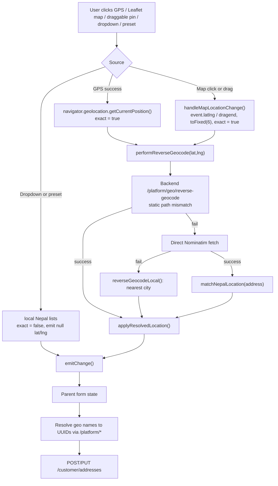

---

## 5. Geocoding and Reverse Geocoding

### 5.1 Backend reverse geocoding — IMPLEMENTED / PARTIAL

File: `app/Modules/Platform/Presentation/Http/Controllers/GeoController.php`  
Method: `public function reverseGeocode(Request $request): JsonResponse` (lines 62-116)

Registered route: `GET /api/v1/platform/reverse-geocode?lat=&lng=` with `throttle:public` (`app/Modules/Platform/Routes/api.php:17`). `throttle:public` is `Limit::perMinute(60)->by($job->ip())` in `app/Modules/Shared/Providers/SharedServiceProvider.php:23`.

Request validation:

```php
'lat' => 'required|numeric|between:-90,90',
'lng' => 'required|numeric|between:-180,180',
```

Primary provider call:

```php
Http::withHeaders([
    'User-Agent' => 'GOSIKA-Ecommerce/1.0 (contact@gosika.sital.info.np)',
    'Accept' => 'application/json',
])->timeout(8)->get('https://nominatim.openstreetmap.org/reverse', [
    'format' => 'json',
    'lat' => $lat,
    'lon' => $lng,
    'addressdetails' => 1,
    'accept-language' => 'en',
]);
```

Example success `data`:

```json
{
  "province": { "uuid": "<province-uuid>", "name": "Bagmati Province" },
  "district": { "uuid": "<district-uuid>", "name": "Kathmandu" },
  "municipality": { "uuid": "<municipality-uuid>", "name": "Kathmandu Metropolitan City" },
  "address_line": "Thamel, Kathmandu",
  "display_name": "Thamel, Kathmandu, Bagmati Province, Nepal"
}
```

Message is `Location resolved.` even if Nominatim succeeds but local name matching returns `null` geo objects; local fallback is used only on HTTP failure/exception. Fallback `fallbackReverseGeocode()` (lines 336-382) chooses the nearest of 15 hard-coded Nepal hubs by Euclidean degree distance and returns message `Location approximated.` Failure returns HTTP 404 with `Unable to determine location from coordinates.`

Helper methods: `matchProvince()`, `matchDistrict()`, `matchMunicipality()`, `buildAddressLine()`, `normalizeName()`, `extractCoreName()`, `fallbackReverseGeocode()`.

### 5.2 Frontend reverse-geocoding chain — PARTIAL

`performReverseGeocode()` (`LocationMapPicker.jsx:219-261`) is invoked by GPS success and `handleMapLocationChange()` (Leaflet click/drag):

1. `api.get('/platform/geo/reverse-geocode', { params: { lat, lng } })`.
2. Direct `fetch('https://nominatim.openstreetmap.org/reverse?...')` then `matchNepalLocation(osmData.address)`.
3. `reverseGeocodeLocal(lat, lng)`; if none matches, coordinates are emitted with a status message and no resolved address fields.

**Verified static defect:** with axios `baseURL: '/api/v1'`, step 1 becomes `/api/v1/platform/geo/reverse-geocode`, while the registered route is `/api/v1/platform/reverse-geocode`. No matching route was found. A deployed proxy rewrite is **NOT VERIFIED**.

### 5.3 Forward geocoding and autocomplete — MISSING

- No address/text → coordinates API implementation was found.
- No Google Places/Api autocomplete, Nominatim search, or equivalent endpoint was found.
- The `autocomplete` string in tests refers to product suggestions, not address search.
- `frontend/src/utils/nepalLocations.js` provides static capital/district coordinates only.
- Cascading dropdowns are local name lists, not geocoding results.

### 5.4 Local geocoding helpers — IMPLEMENTED / PARTIAL

File: `frontend/src/utils/nepalLocations.js`

| Symbol | Lines | Behavior |
|---|---|---|
| `RAW_LOCAL_LEVEL` | 4+ | 753 compact records copied from `resources/js/location.js`. |
| `PROVINCE_MAP` | 761-769 | Maps source province `"1"` to `Koshi Province`; others to `<Name> Province`. |
| `NEPAL_PROVINCES` | 790 | Sorted province display names. |
| `NEPAL_DISTRICTS` | 792-795 | District names keyed by province. |
| `NEPAL_MUNICIPALITIES` | 797-801 | `{name,type}` arrays keyed by district name only. |
| `getDistrictsForProvince()` | 803-807 | Normalizes province name and returns local list. |
| `getMunicipalitiesForDistrict(district, province)` | 809-820 | Province argument is not used. |
| `CITY_COORDS` | 822-845 | 22 city coordinate records. |
| `DISTRICT_ALIAS_MAP` | 847-865 | Frontend aliases such as `nawalpur → Nawalparasi East`. |
| `matchNepalLocation(addr = {})` | 867-1017 | Converts Nominatim-style address objects to province/district/municipality/street strings. |
| `reverseGeocodeLocal(lat, lng)` | 1019-1041 | Nearest-city fallback using Euclidean distance; no polygons/GIS. |

---

## 6. Database Structure

### 6.1 Entity relationship diagram — IMPLEMENTED

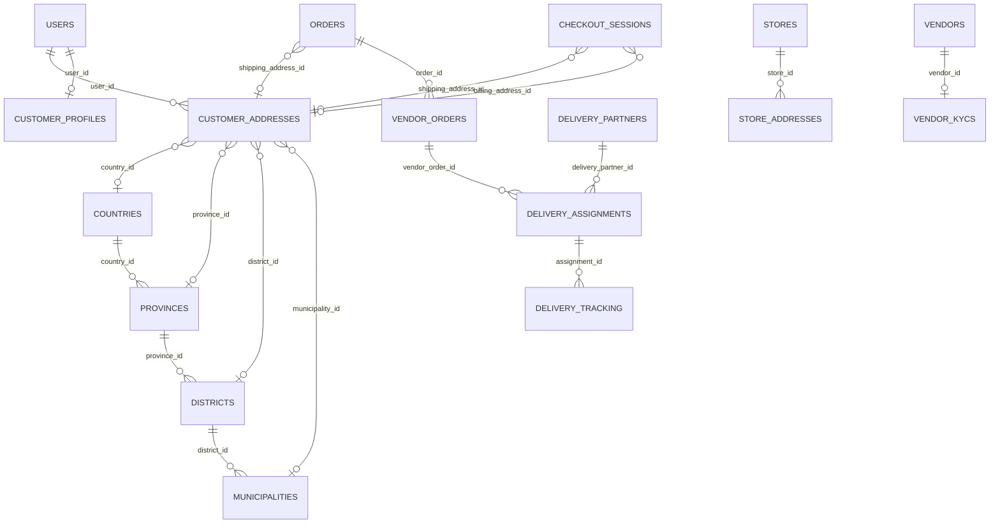

`shipping_zones` and `couriers` intentionally have no FK relationships in the current schema. `shipping_zones.provinces` is a JSON array of province-name strings.

### 6.2 Geo tables — IMPLEMENTED

Migration: `database/migrations/2026_08_15_000001_create_platform_tables.php`

| Table | Columns |
|---|---|
| `countries` | `id`, `uuid` unique, `name string(120)`, `code string(4)` unique, `phone_code string(10)` nullable, `is_active boolean default true`, audit columns, timestamps. |
| `provinces` | `id`, `uuid` unique, `country_id` FK cascade, `name string(120)`, `code string(20)` nullable, `is_active boolean default true`, audit columns, timestamps. |
| `districts` | `id`, `uuid` unique, `province_id` FK cascade, `name string(120)`, `code string(20)` nullable, `is_active boolean default true`, audit columns, timestamps. |
| `municipalities` | `id`, `uuid` unique, `district_id` FK cascade, `name string(120)`, `type string(30)` nullable, `ward_count integer default 1`, `is_active boolean default true`, audit columns, timestamps. |

No unique constraints exist on province/district/municipality names or codes. No GeoJSON, polygon, boundary, latitude, longitude, ward table, tole, or locality column exists.

### 6.3 Address / checkout / order tables — IMPLEMENTED

| Table | Relevant columns | Source |
|---|---|---|
| `customer_addresses` | Full schema in Section 3.1 | `2026_08_15_000004_create_customer_tables.php` |
| `customer_profiles` | `id`, `uuid`, `user_id` unique FK, `gender`, `date_of_birth`, `default_shipping_address_id string`, `default_billing_address_id string`, `preferences json`, audit columns, timestamps | same migration lines 11-23 |
| `checkout_sessions` | `id`, `uuid`, `user_id` nullable FK, `cart_id` nullable FK, `shipping_address_id` nullable FK → `customer_addresses.id`, `billing_address_id` nullable FK, `coupon_code`, `payment_method`, `subtotal`, `discount`, `delivery_charge`, `tax`, `total`, `status` default pending, `shipping_breakdown json`, `meta json`, `expires_at`, audit columns, timestamps | `2026_08_15_000006_create_checkout_tables.php` |
| `orders` | `id`, `uuid`, `order_number`, `user_id` FK, `checkout_session_id` nullable FK, `shipping_address_id` nullable FK, `shipping_address_snapshot string(1000)`, payment/status/totals/currency NPR, `meta json`, timestamps/status timestamps, soft deletes | `2026_08_15_000007_create_order_tables.php:11-44` |
| `vendor_orders` | `id`, `uuid`, `order_id`, `vendor_id`, `store_id`, `status`, `delivery_status`, `items_subtotal`, `discount`, `delivery_charge`, `tax`, `grand_total`, commission fields, `delivery_partner_name`, `meta`, soft deletes | same migration lines 46-73 |
| `store_addresses` | `id`, `uuid`, `store_id` FK, `address_type` default `business`, address lines, four nullable geo FKs, `postal_code`, `landmark`, `latitude string(20)`, `longitude string(20)` | `2026_08_15_000002_create_vendor_tables.php:129-147` |
| `vendor_kycs` | `id`, `uuid`, `vendor_id`, plain-text `province`, `district`, `municipality`, `address`, `landmark`, `latitude`, `longitude`, `status`, review fields | same migration lines 61-84 |

### 6.4 Shipping tables — IMPLEMENTED

Migration: `database/migrations/2026_08_15_000011_create_shipping_tables.php`

| Table | Columns relevant to this audit |
|---|---|
| `shipping_zones` | `id`, `uuid` unique, `name string(180)`, `description text`, `provinces json` nullable with comment “Nepal province names covered by this zone”, `standard_charge decimal(12,2)` default 0, `express_charge decimal(12,2)` default 0, `estimated_days unsignedTinyInteger` default 2, `is_active boolean` default true, audit columns, timestamps, soft deletes, index on `is_active`. |
| `couriers` | `id`, `uuid` unique, `name string(180)`, `code string(60)` unique nullable, `logo`, `contact_phone`, `contact_email`, `tracking_url_pattern string(500)`, `description text`, `is_active`, audit columns, timestamps, soft deletes. |
| `delivery_partners` | `id`, `uuid`, `user_id` FK, `name`, `phone` unique, vehicle fields, insurance expiry, `service_areas json`, `status` default pending, `is_online`, ratings, `latitude decimal(10,7)`, `longitude decimal(10,7)`, `last_location_at`, `meta json`, approval fields, soft deletes. |
| `delivery_assignments` | `id`, `uuid`, `vendor_order_id`, `delivery_partner_id`, `status`, `delivery_fee decimal(12,2)`, `cod_amount`, COD reconciliation, `pickup_address string(500)`, `dropoff_address string(500)`, recipient fields, lifecycle timestamps, proof photo, `meta`, soft-delete audit fields. |
| `delivery_tracking` | `id`, `uuid`, `assignment_id`, `vendor_order_id`, `status`, `latitude decimal(10,7)`, `longitude decimal(10,7)`, `note text`, `tracked_at`, audit columns, timestamps. |
| `delivery_partner_documents` | document metadata and links; not directly used for zone/pricing logic. |

### 6.5 Coordinate storage summary — IMPLEMENTED

| Table | Column types |
|---|---|
| `customer_addresses` | `latitude string(20)`, `longitude string(20)` |
| `store_addresses` | `latitude string(20)`, `longitude string(20)` |
| `vendor_kycs` | `latitude string(20)`, `longitude string(20)` |
| `delivery_partners` | `latitude decimal(10,7)`, `longitude decimal(10,7)` |
| `delivery_tracking` | `latitude decimal(10,7)`, `longitude decimal(10,7)` |
| `orders` | Coordinates only inside `shipping_address_snapshot` JSON; no direct columns. |

---

## 7. Geographical Data Management

### 7.1 Implemented hierarchy and ID assignment — IMPLEMENTED

The database hierarchy is:

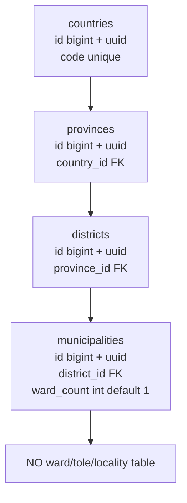

- Internal relationships use auto-increment `id` FKs.
- Public API identifiers use `uuid`.
- The frontend resolves display names to UUIDs, then `CustomerService::resolveLocationIds()` converts UUIDs to numeric FK IDs.
- No ward entity/ID exists. “Ward” is only free text such as the `LocationMapPicker` placeholder `e.g. Main Bazaar Road, Ward 4`.

### 7.2 Source data and seeder — IMPLEMENTED

Source: `resources/js/location.js` (`const localLevel = [...]`, `export default localLevel;`, 4,522 lines).

Static dataset counts:

| Metric | Count |
|---|---:|
| Local-level records | 753 |
| Unique district names | 77 |
| Province 1 (Koshi) records | 137 |
| Madhesh | 136 |
| Bagmati | 119 |
| Gandaki | 85 |
| Lumbini | 109 |
| Karnali | 79 |
| Sudurpaschim | 88 |
| Rural Municipality | 460 |
| Municipality | 276 |
| Metropolitan City | 6 |
| Sub-Metropolitan City | 11 |

Seeder: `database/seeders/NepalGeoSchemaSeeder.php`, invoked from `database/seeders/DatabaseSeeder.php:13`.

- Creates `NP` / Nepal / `+977`.
- Creates 7 provinces with codes `P1`–`P7`.
- Creates 77 districts with `code = strtoupper(Str::slug($districtName, ''))`.
- Imports all 753 local-level records from `resources/js/location.js` into `municipalities`.
- Applies aliases: `TANAHU→Tanahun`, `NAWALPARASI EAST→Nawalpur`, `NAWALPARASI WEST→Parasi`, `RUKUM EAST→Eastern Rukum`, `RUKUM WEST→Western Rukum`, `KAPILBASTU→Kapilvastu`, `DHANUSA→Dhanusa`.
- Stores `type` as lowercase with underscores (e.g. `rural_municipality`) and `ward_count = 1` for every imported municipality.
- `$majorCities` in the seeder is unused; it contains 211 city-name entries, while `docs/02-architecture.md:80` says 208. That documentation count is stale.
- Actual seeded database row counts are **NOT VERIFIED**; no database was queried.

### 7.3 Duplication and drift — IMPLEMENTED / PARTIAL

- `frontend/src/utils/nepalLocations.js` embeds the same 753 records as `resources/js/location.js`; static comparison found 0 record differences at audit time.
- Frontend `titleCase()` does not apply seeder aliases. `DISTRICT_ALIAS_MAP` maps in the opposite direction for Nominatim matching.
- Resulting name drift examples:

| Frontend picker value | Seeded backend district | Name-resolution result |
|---|---|---|
| `Tanahu` | `Tanahun` | Matches via `includes`. |
| `Dhanusa` | `Dhanusa` | Matches. |
| `Nawalparasi East` | `Nawalpur` | No match; IDs remain null. |
| `Nawalparasi West` | `Parasi` | No match; IDs remain null. |
| `Rukum East` | `Eastern Rukum` | No match; IDs remain null. |
| `Rukum West` | `Western Rukum` | No match; IDs remain null. |
| `Kapilbastu` | `Kapilvastu` | No match; IDs remain null. |

Runtime form submissions for these values are **NOT VERIFIED**; mismatch is proven statically from code/data.

### 7.4 Cascading dropdown implementations — IMPLEMENTED / PARTIAL

Two distinct dropdown systems exist:

1. **Inside `LocationMapPicker`:** local hardcoded `NEPAL_PROVINCES`, `getDistrictsForProvince()`, `getMunicipalitiesForDistrict()`; values are display-name strings. No API call.
2. **Address save resolution:** `AccountAddresses.jsx::resolveGeoIds()` and `Checkout.jsx::resolveGeoIds()` call `/platform/provinces`, then `/platform/districts?province_id=<integer id>`, then `/platform/municipalities?district_id=<integer id>` and submit UUIDs.

Other consumers:

| File | Usage |
|---|---|
| `frontend/src/pages/admin/AdminShipping.jsx` | Derives province options from `NEPAL_DISTRICTS`; stores zone coverage as province-name strings; displays `districts.slice(0, 6)` as “hubs”. |
| `frontend/src/pages/delivery/DeliveryProfile.jsx` | Stores comma-separated province-name strings in `service_areas`. |
| `frontend/src/pages/vendor/VendorVerification.jsx`, `frontend/src/components/vendor/SellerOnboardingCard.jsx` | Uses picker; sends location strings. |
| `frontend/src/pages/admin/AdminManualOrderForm.jsx` | Uses picker; sends nested snapshot strings. |
| `frontend/src/utils/constants.js` | Re-exports helpers and duplicates 13 city coordinates / 8 popular-location presets. |

### 7.5 Geo API endpoints and response shapes — IMPLEMENTED

Routes: `app/Modules/Platform/Routes/api.php:13-17`, all with `throttle:public` and no auth.

Example `GET /api/v1/platform/provinces`:

```json
{
  "success": true,
  "message": "Provinces retrieved.",
  "data": [
    { "id": 3, "uuid": "<province-uuid>", "name": "Bagmati Province", "code": "P3" }
  ],
  "meta": []
}
```

Example `GET /api/v1/platform/districts?province_id=3`:

```json
{
  "success": true,
  "message": "Districts retrieved.",
  "data": [
    { "id": 18, "uuid": "<district-uuid>", "province_id": 3, "name": "Kathmandu", "code": "KATHMANDU" }
  ],
  "meta": []
}
```

Example `GET /api/v1/platform/municipalities?district_id=18`:

```json
{
  "success": true,
  "message": "Municipalities retrieved.",
  "data": [
    {
      "id": 91,
      "uuid": "<municipality-uuid>",
      "district_id": 18,
      "name": "Kathmandu Metropolitan City",
      "type": "metropolitan_city",
      "ward_count": 1
    }
  ],
  "meta": []
}
```

Filters use integer FK columns, not UUIDs.

### 7.6 Hierarchy integrity validation — PARTIAL

Implemented:

- DB FKs enforce parent existence and cascade deletes.
- Address request validates each UUID exists in its own table.
- Dependent dropdowns query children by selected parent numeric ID.
- `VendorOnboardingService` resolves province/district/municipality strings with exact `LOWER(name) = LOWER(?)` before writing `store_addresses` IDs.

Not implemented:

- No API/server validation that `district_id` belongs to `province_id`.
- No API/server validation that `municipality_id` belongs to `district_id`.
- No unique constraints on names/codes.
- No ward-level validation or storage.

### 7.7 Plain-text geography duplication — IMPLEMENTED

Plain-text location fields exist in:

- `vendor_kycs.province`, `.district`, `.municipality`, `.address`, `.landmark`.
- `shipping_zones.provinces` (JSON strings).
- `delivery_partners.service_areas` (JSON strings).
- `orders.shipping_address_snapshot` province/district/municipality names.
- Manual-order `shipping_address` inputs.
- `VendorOrderResource` placeholder defaults such as `Baluwatar, Ward 4`, `Kathmandu Metropolitan City`, `Biratnagar`, `Morang`.

---

## 8. Admin Shipping Zone Management

### 8.1 Admin screen — IMPLEMENTED / PARTIAL

File: `frontend/src/pages/admin/AdminShipping.jsx`  
Route: `/admin/fulfillment/zones` (`frontend/src/App.jsx:427`) behind `PermissionGuard`.

Observed behavior:

- Zone form initial state: `EMPTY_ZONE = { name:'', provinces:'', standard_charge:150, express_charge:250, estimated_days:2 }`.
- `saveZone()` builds `provinces` by splitting a comma string into an array and posts `/admin/shipping/zones` or puts `/admin/shipping/zones/{id}`.
- Courier form maps UI `endpoint` to backend `tracking_url_pattern`; `type` and `coverage` are joined into `description` with `' · '`.
- “Delivery Coverage Map” is a static decorative panel. “Coverage synced with shipping zones” is UI copy, not a sync mechanism.
- Table header “Covered Districts / Hubs” renders only `zone.provinces`; no district/hub data is stored.

### 8.2 Backend CRUD — IMPLEMENTED

Routes: `app/Modules/Shipping/Routes/api.php:93-103`, prefix `/api/v1/admin/shipping`, middleware `auth:sanctum`, `ensure:admin`.

Controller: `app/Modules/Shipping/Presentation/Http/Controllers/AdminShippingController.php` (constructor also applies `auth:sanctum`, `admin`, `permission:'.Permissions::DELIVERIES_MANAGE`).

| Method | Path | Controller method |
|---|---|---|
| GET | `/api/v1/admin/shipping/zones` | `zones(Request $request): JsonResponse` |
| POST | `/api/v1/admin/shipping/zones` | `storeZone(Request $request): JsonResponse` |
| PUT | `/api/v1/admin/shipping/zones/{zone}` | `updateZone(Request $request, string $zoneId): JsonResponse` |
| DELETE | `/api/v1/admin/shipping/zones/{zone}` | `deleteZone(string $zoneId): JsonResponse` |
| GET | `/api/v1/admin/shipping/couriers` | `couriers(Request $request): JsonResponse` |
| POST | `/api/v1/admin/shipping/couriers` | `storeCourier(Request $request): JsonResponse` |
| PUT | `/api/v1/admin/shipping/couriers/{courier}` | `updateCourier(Request $request, string $courierId): JsonResponse` |
| DELETE | `/api/v1/admin/shipping/couriers/{courier}` | `deleteCourier(string $courierId): JsonResponse` |

Zone validation:

```php
// storeZone
'name' => ['required', 'string', 'max:180'],
'description' => ['nullable', 'string', 'max:1000'],
'provinces' => ['array'],
'provinces.*' => ['string', 'max:120'],
'standard_charge' => ['required', 'numeric', 'min:0'],
'express_charge' => ['required', 'numeric', 'min:0'],
'estimated_days' => ['required', 'integer', 'min:1', 'max:30'],
'is_active' => ['boolean'],
```

`updateZone()` uses the same rules with `sometimes` on `name`, `standard_charge`, `express_charge`, and `estimated_days`. Lookup is `ShippingZone::where('uuid', $zoneId)->firstOrFail()`; delete is a soft delete.

Example create request:

```json
{
  "name": "Bagmati Standard",
  "description": "Province-wide ground delivery",
  "provinces": ["Bagmati Province", "Kathmandu"],
  "standard_charge": 80,
  "express_charge": 150,
  "estimated_days": 2,
  "is_active": true
}
```

Example 201 response `data` from `ShippingZoneResource`:

```json
{
  "id": "<zone-uuid>",
  "name": "Bagmati Standard",
  "description": "Province-wide ground delivery",
  "provinces": ["Bagmati Province", "Kathmandu"],
  "standard_charge": "80.00",
  "express_charge": "150.00",
  "estimated_days": 2,
  "is_active": true,
  "created_at": "2026-11-26T00:00:00.000000Z"
}
```

### 8.3 Coverage definition — PARTIAL

- Coverage is `shipping_zones.provinces` JSON containing free-text province names (and sometimes district names entered by admins).
- There are no zone→province/district FK tables.
- `estimated_days` is stored and displayed but no producer/consumer assigning delivery ETA from it was found.
- `is_active` is consulted only in `DeliveryService::candidateAreasFor()` via `where('is_active', true)`.

### 8.4 Zone matching algorithm — IMPLEMENTED

`app/Modules/Shipping/Infrastructure/Models/ShippingZone.php:33-56`:

```php
public function matchesLocation(?string $province = null, ?string $district = null, ?string $municipality = null): bool
```

Behavior:

- Returns `false` if `provinces` is empty or all inputs are empty.
- Lowercases inputs and stored province names.
- Returns `true` on equality or either-direction substring match between any of province/district/municipality and any stored province name.
- Despite parameter names, it does not use geo IDs and has no district-specific column.

### 8.5 Zone usage in delivery operations — PARTIAL

`DeliveryService::candidateAreasFor(VendorOrder $vendorOrder)` (`app/Modules/Shipping/Application/Services/DeliveryService.php:1254-1287`):

1. Reads `orders.shipping_address_snapshot`.
2. Extracts `province|state`, `district|city`, `municipality`.
3. Loads active `ShippingZone`s and filters by `matchesLocation()`.
4. Merges each matched zone’s `provinces` and `zone->name` into a deduplicated candidate-area list.
5. `partnerMatchesAreas()` compares candidates with `delivery_partners.service_areas`. This check runs only when `assignOrder()` is called with `method: 'self_claim'`; admin `assign()` and `reassign()` pass `method: 'manual_admin'` and skip it.

Zones are therefore used for rider self-claim eligibility, not for checkout price or ETA. `resolvePartnerForOrder()` also uses this area logic but has no active production call site found.

### 8.6 Zone/partner/hub associations — MISSING / PARTIAL

| Association | Finding |
|---|---|
| Zone → Delivery Partner | **PARTIAL / INDIRECT:** no FK; matching is invoked only on `self_claim` between zone-expanded candidate areas and `delivery_partners.service_areas`. Admin/reassignment paths skip it. |
| Zone → Delivery Hub | **MISSING:** no hub entity/table found. |
| Zone → Courier | **MISSING:** `couriers` has no zone relation and no outbound integration found. |
| Production zone seeder | **MISSING:** only `QaTestDataSeeder.php:491-506` creates `ZONE-X` / `ZONE-Y` QA data. |

### 8.7 Admin zone flow — IMPLEMENTED

```mermaid
flowchart LR
    A["AdminShipping.jsx zone modal"] --> B["saveZone()"]
    B --> C["POST/PUT /admin/shipping/zones"]
    C --> D["AdminShippingController::storeZone/updateZone"]
    D --> E["Validate name, provinces[], charges, days, is_active"]
    E --> F["ShippingZone::create/update"]
    F --> G["ShippingZoneResource"]
    G --> H["Zone list refresh"]
    H --> I["DeliveryService::candidateAreasFor() at assignment time"]
    I --> J["partnerMatchesAreas()"]
```

---

## 9. Shipping Rate Configuration

### 9.1 Settings endpoints — IMPLEMENTED

Routes: `app/Modules/Platform/Routes/api.php:23-52`, middleware `auth:sanctum`, `ensure:admin`, `throttle:admin`.

| Method | Path | Controller |
|---|---|---|
| GET | `/api/v1/admin/settings/shipping` | `AdminSettingsController::getShipping()` |
| PUT | `/api/v1/admin/settings/shipping` | `AdminSettingsController::updateShipping(UpdateShippingSettingsRequest $request)` |
| GET / PUT | `/api/v1/admin/settings` | `SettingsController::index()` / `batchUpdate()` legacy fallback |
| PUT | `/api/v1/admin/settings/{key}` | `SettingsController::update()` legacy fallback |

`AdminSettingsController::getShipping()` calls `SettingsService::getGroup('shipping', false)`; `updateShipping()` calls `SettingsService::updateGroup('shipping', $request->validated(), $request->user())`. `SettingsService::get()` is a read-through cache with `CACHE_TTL = 3600` seconds; `updateGroup()` forgets the group and public-config cache keys. Checkout and order pricing call `Setting::get()` directly, so this service cache is not in the pricing path.

### 9.2 Validation keys — IMPLEMENTED

`app/Modules/Platform/Presentation/Http/Requests/UpdateShippingSettingsRequest.php:14-40` defines only bare keys:

```php
'shipping_enabled'          => ['nullable', 'boolean'],
'default_provider'          => ['nullable', 'string', 'max:50'],
'calculation_method'        => ['nullable', 'string', 'in:flat_rate,weight_based,distance_based,provider_based'],
'flat_charge'               => ['nullable', 'numeric', 'min:0'],
'free_delivery_threshold'   => ['nullable', 'numeric', 'min:0'],
'max_shipping_fee'          => ['nullable', 'numeric', 'min:0'],
'fee_responsibility'        => ['nullable', 'string', 'in:customer,vendor,platform,split'],
'cod_enabled'               => ['nullable', 'boolean'],
'cod_fee'                   => ['nullable', 'numeric', 'min:0'],
'cod_min_amount'            => ['nullable', 'numeric', 'min:0'],
'cod_max_amount'            => ['nullable', 'numeric', 'min:0'],
'cod_instructions'          => ['nullable', 'string', 'max:500'],
'allow_returns'             => ['nullable', 'boolean'],
'return_window_days'        => ['nullable', 'integer', 'min:1', 'max:90'],
'return_shipping_paid_by'   => ['nullable', 'string', 'in:customer,vendor,platform'],
'auto_refund_on_return'     => ['nullable', 'boolean'],
'default_refund_method'     => ['nullable', 'string', 'in:original_payment,wallet,manual'],
'restocking_fee'            => ['nullable', 'numeric', 'min:0'],
```

`SettingsService::updateGroup()` writes each validated key verbatim via `Setting::set($key, ...)` (lines 91-163). It does not add or translate prefixes.

### 9.3 Seeded defaults — IMPLEMENTED

`database/seeders/SettingsSeeder.php`:

```php
['shipping.flat_charge', '80', 'shipping', 'decimal', true],
['shipping.free_delivery_threshold', '2000', 'shipping', 'decimal', true],
['checkout.cod_enabled', 'true', 'checkout', 'boolean', true],
['checkout.cod_max_amount', '50000', 'checkout', 'decimal', true],
['checkout.min_order_amount', '0', 'checkout', 'decimal', true],
```

Pricing reads the prefixed keys `shipping.flat_charge` and `shipping.free_delivery_threshold`.

### 9.4 Broken key linkage — IMPLEMENTED CODE-LEVEL DEFECT

`frontend/src/components/admin/settings/ShippingTab.jsx:57-77` writes both bare and prefixed keys:

```js
handleChange('flat_charge', value)
handleChange('shipping.flat_charge', value)

handleChange('free_delivery_threshold', value)
handleChange('free_shipping_threshold', value)
handleChange('shipping.free_delivery_threshold', value)
```

`frontend/src/pages/admin/AdminSettings.jsx:137` sends the whole `formData` to `/admin/settings/shipping`. The controller uses `$request->validated()`, which contains only ruled keys. Therefore on a successful primary save:

- bare `flat_charge` / `free_delivery_threshold` rows are created/updated in group `shipping`;
- prefixed `shipping.flat_charge` / `shipping.free_delivery_threshold` are dropped;
- `CheckoutService`, `OrderService`, and `AdminManualOrderForm` continue reading the seeded/unchanged prefixed values.

A legacy fallback (`PUT /admin/settings` with all keys) runs only when the primary request errors (`AdminSettings.jsx:137-145`). Runtime confirmation of a deployed save is **NOT VERIFIED**.

### 9.5 Effective shipping formula — IMPLEMENTED

Implemented identically in `CheckoutService::deliveryCharge()` (`app/Modules/Checkout/Application/Services/CheckoutService.php:166-176`) and `OrderService::deliveryCharge()` (`app/Modules/Order/Application/Services/OrderService.php:539-549`):

```php
$flat = (float) Setting::get('shipping.flat_charge', 80);
$freeThreshold = (float) Setting::get('shipping.free_delivery_threshold', 2000);

if ($freeThreshold > 0 && $subtotal >= $freeThreshold) {
    return 0.0;
}

return $flat;
```

Charges are computed **per vendor group** and summed:

- `CheckoutService::deliveryChargeForItems()` groups cart items by `product.vendor_id`.
- `OrderService::vendorDeliveryCharges()` repeats the grouping for `vendor_orders.delivery_charge`.
- `orders.delivery_charge` is copied from `checkout_sessions.delivery_charge`.

No address, coordinates, zone, weight, distance, or provider value is an input to this formula.

### 9.6 UI-only or unconsumed configuration — IMPLEMENTED UI / MISSING CONSUMER

No consumer found in `app/` for: `shipping_enabled`, `default_provider`, `calculation_method`, `max_shipping_fee`, `fee_responsibility`, `cod_fee`, `restocking_fee`, `return_shipping_paid_by`, `auto_refund_on_return`, `default_refund_method`.

`cod_enabled` is saved bare by the shipping endpoint, while checkout reads `checkout.cod_enabled` / `payment.cod_enabled` / bare `cod_enabled`; the payments endpoint maps `cod_enabled` to prefixed keys, but the shipping-tab toggle has the same key-linkage problem.

`return_window_days` is saved bare while `WalletResource.php:14` reads `return.window_days`.

### 9.7 Zone rates and express rates — PARTIAL / UI ONLY

- `shipping_zones.standard_charge`, `.express_charge`, `.estimated_days` are stored and editable.
- No checkout/order code queries `ShippingZone` for pricing.
- No express-delivery selection exists in the storefront code found.
- `AdminManualOrderForm.jsx:125-135,240-260,378` mirrors the same flat-fee/free-threshold formula client-side from `/admin/settings/shipping`.
- `AdminOrderController::manualCreate()` accepts the client-computed order-level `delivery_charge`, but hardcodes each `vendor_orders.delivery_charge = 0` and `vendor_orders.grand_total = group subtotal` (`AdminOrderController.php:660-677`), so manual orders diverge from customer orders.

---

## 10. Shipping Calculation Workflow

### 10.1 End-to-end trace — PARTIAL

The implemented workflow is a split path: address/geo data is captured and snapshotted, while price is calculated independently from cart subtotal and settings.

```mermaid
sequenceDiagram
    participant P as LocationMapPicker
    participant A as AccountAddresses / Checkout
    participant C as CustomerService
    participant CS as CheckoutService
    participant O as OrderService
    participant D as DeliveryService

    P->>A: province/district/municipality strings + lat/lng
    A->>A: resolveGeoIds() via /platform/* (UUIDs)
    A->>C: POST /customer/addresses (UUIDs)
    C->>C: resolveLocationIds() -> numeric FK IDs
    C-->>A: address UUID

    A->>CS: POST /checkout (address UUID)
    CS->>C: ownedAddress()
    CS->>CS: summary(): subtotal, tax, deliveryChargeForItems()
    Note over CS: deliveryCharge uses only Setting values<br/>flat_charge + free_delivery_threshold per vendor
    CS-->>A: session UUID + charges

    A->>O: POST /orders (session UUID)
    O->>O: placeOrder(): addressSnapshot(), totals copied
    O-->>A: order UUID

    D->>D: assignOrder(): lock vendor order, require approved partner
    Note over D: self_claim only: candidateAreasFor() -> matchesLocation() -> partnerMatchesAreas()
    Note over D: Admin assign/reassign pass manual_admin and skip area checks;<br/>resolvePartnerForOrder() exists but has no active caller found
    D-->>D: delivery assignment or 403/409/422 error
```

### 10.2 Step-by-step findings

| Step | Implemented behavior | Evidence |
|---|---|---|
| Cart → checkout | `CartResource` exposes only `item_count`, `line_count`, and `subtotal`; UI says “Calculated at checkout.” Cart total equals selected subtotal. | `CartResource.php:14-23`, `Cart.jsx:435-446` |
| Address selection → coordinate extraction | Picker emits `latitude`, `longitude`, and `coordinates` only when `coordinatesAreExact`; Leaflet click/drag and GPS success set that flag. Dropdown/preset values emit `null` coordinates. | `LocationMapPicker.jsx::emitChange()` lines 126-155, `handleMapLocationChange()` lines 263-270 |
| Coordinates → geo ID resolution | Coordinates are **not** used for ID resolution. IDs come from name matching against `/platform/*` endpoints. | `AccountAddresses.jsx::resolveGeoIds()`, `Checkout.jsx::resolveGeoIds()` |
| Geo ID → zone matching | Zones do **not** use geo IDs. `matchesLocation()` compares snapshot name strings with `shipping_zones.provinces` strings. | `ShippingZone.php:33-56`, `DeliveryService.php:1261-1275` |
| Serviceability check | No checkout serviceability endpoint. In `assignOrder()`, active zone expansion + partner `service_areas` are checked **only for `self_claim`**; admin assign/reassign pass `manual_admin` and skip the check. Empty/wildcard partner areas match all. | `DeliveryService.php:249-253`, `342-361`, `432-441`, `1289-1319` |
| Partner selection | `resolvePartnerForOrder()` filters approved + online partners by area, sorts by count of service areas descending, and takes first; no production call site was found. Active paths call `assignOrder()` directly. | `DeliveryService.php:1169-1194`; repository-wide grep |
| Rate retrieval | `Setting::get('shipping.flat_charge', 80)` and `Setting::get('shipping.free_delivery_threshold', 2000)`. | `CheckoutService.php:168-169`, `OrderService.php:541-542` |
| Charge calculation | Per-vendor flat fee waived when vendor subtotal ≥ threshold. | `deliveryChargeForItems()`, `vendorDeliveryCharges()` |
| Checkout display | `Checkout.jsx:648,726` renders `summary.delivery_charge` from `GET /checkout/summary` or session total. | `frontend/src/pages/Checkout.jsx` |
| Persistence | `checkout_sessions.delivery_charge`, `orders.delivery_charge`, `vendor_orders.delivery_charge`. | migrations + services |
| Error/fallback | Empty cart 422; address not found 422; payment gateway/COD rules 422; detached `resolvePartnerForOrder()` 422 manual-assignment message; active `self_claim` 403 outside service areas; geocode fallback approximations. | services and controllers |

### 10.3 Serviceability decision logic — IMPLEMENTED / PARTIAL

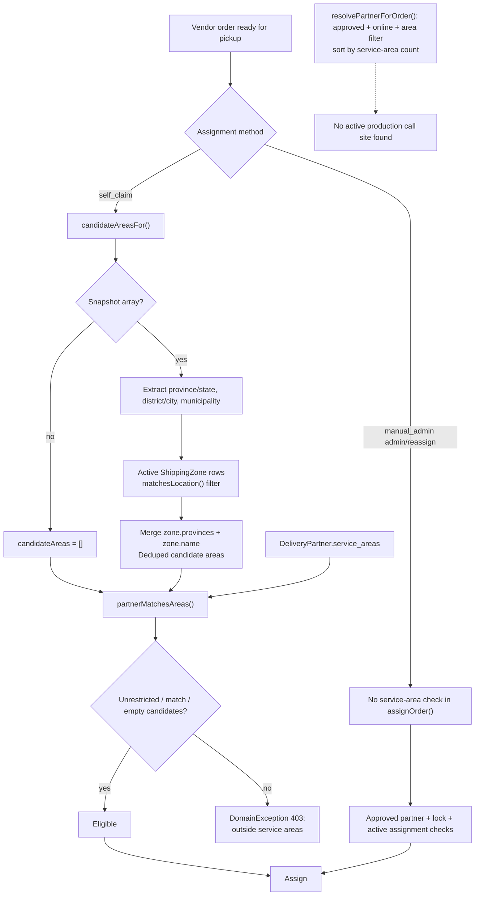

### 10.4 Hardcoded business rules — IMPLEMENTED

| Rule | Value / behavior | Source |
|---|---|---|
| Default flat delivery charge | `80` NPR | `CheckoutService.php:168`, `OrderService.php:541`, `SettingsSeeder.php:18` |
| Default free-delivery threshold | `2000` NPR | `CheckoutService.php:169`, `OrderService.php:542`, `SettingsSeeder.php:19` |
| Charge grouping | Per `product.vendor_id` | `CheckoutService.php:158`, `OrderService.php:531` |
| Checkout session TTL | `checkout.session_ttl_minutes`, default 30 minutes, set but no enforcement found | `CheckoutService.php:122`, `pendingFor()` lines 129-135 |
| GPS fallback display coordinates | `27.7172`, `85.3240`; marked inexact and emitted as `null` | `LocationMapPicker.jsx:400-407`, `emitChange()` lines 136-141 |
| Map/GPS coordinate precision | 6 decimals | `LocationMapPicker.jsx:263-265`, `392-393` |
| OSRM road-route endpoint | `https://router.project-osrm.org/route/v1/driving/...`; exact endpoints only | `DeliveryRouteMap.jsx:82-93,121-158` |
| Backend reverse-geocode timeout | 8 seconds | `GeoController.php:76` |
| Local reverse-geocode hubs | 15 hardcoded Nepal hubs | `GeoController.php:339-355` |
| Frontend local city coordinate table | 22 cities | `nepalLocations.js:822-845` |
| Partner wildcard areas | `*`, `all`, `nepal`, `all areas` match everything | `DeliveryService.php:1293-1300` |
| No-partner fallback | 422 requiring manual assignment | `DeliveryService.php:1189-1191` |
| Delivery OTP | 6-digit random for COD order; separate assignment OTP flow | `OrderService.php:431-435`, `DeliveryService.php:1728+` |

### 10.5 Charge flow example

Given vendor A subtotal 1500 and vendor B subtotal 2500 with default settings:

```text
vendor A: 1500 < 2000 -> 80
vendor B: 2500 >= 2000 -> 0
checkout_sessions.delivery_charge = 80
orders.delivery_charge = 80
vendor_orders[ A ].delivery_charge = 80
vendor_orders[ B ].delivery_charge = 0
```

Address, province, district, and zone rates do not change this result.

---

## 11. Checkout and Order Integration

### 11.1 Checkout request validation — IMPLEMENTED

`app/Modules/Checkout/Presentation/Http/Requests/CheckoutRequest.php:14-23`:

```php
'shipping_address_id' => ['required', 'string', 'exists:customer_addresses,uuid'],
'billing_address_id'  => ['nullable', 'string', 'exists:customer_addresses,uuid'],
'payment_method'      => ['sometimes', 'string', 'in:cod,khalti,esewa'],
'item_ids'            => ['nullable', 'array'],
'item_ids.*'          => ['string'],
```

No `address_type` check exists: a billing-type address UUID can be submitted as `shipping_address_id`.

### 11.2 Checkout creation — IMPLEMENTED

`CheckoutService::create(User $user, array $data): CheckoutSession`:

- Loads cart via `CartService::getCart()`.
- Rejects empty cart with `Your cart is empty.` (422).
- Resolves shipping address via `ownedAddress()`; rejects unowned/not-found with `Shipping address not found.` (422).
- Billing falls back to shipping when omitted or unowned.
- Computes summary and payment-method eligibility.
- Persists numeric address IDs to `checkout_sessions`.
- Sets `status = 'pending'` and `expires_at = now()->addMinutes(Setting::get('checkout.session_ttl_minutes', 30))`.
- Returns `fresh(['cart.items.product', 'cart.items.variant', 'shippingAddress', 'billingAddress'])`.

Example request:

```json
{
  "shipping_address_id": "<address-uuid>",
  "billing_address_id": null,
  "payment_method": "cod",
  "item_ids": ["<cart-item-uuid>"]
}
```

Example response `data` from `CheckoutSessionResource`:

```json
{
  "id": "<checkout-session-uuid>",
  "status": "pending",
  "payment_method": "cod",
  "shipping_address": {
    "id": "<address-uuid>",
    "address_type": "shipping",
    "full_name": "Ram Shrestha",
    "phone": "9800000000",
    "address_line_1": "Main Bazaar Road, Ward 4",
    "province": null,
    "district": null,
    "municipality": null,
    "latitude": "27.717200",
    "longitude": "85.324000",
    "is_default": true
  },
  "billing_address": { "id": "<address-uuid>" },
  "subtotal": "1500.00",
  "discount": "0.00",
  "delivery_charge": "80.00",
  "tax": "0.00",
  "total": "1580.00",
  "expires_at": "2026-11-26T00:30:00.000000Z",
  "created_at": "2026-11-26T00:00:00.000000Z"
}
```

Nested geo objects appear as `null` because `fresh()` eager-loads `shippingAddress` but not its nested `country/province/district/municipality` relations.

### 11.3 Session lookup and expiry — PARTIAL

`CheckoutService::pendingFor(User $user, string $uuid): ?CheckoutSession` filters only `forUser` + `uuid`; it does not filter `status = 'pending'` and does not check `expires_at`. `OrderService::placeOrder()` rejects only sessions whose `status !== 'pending'`. No job/middleware enforcing `expires_at` was found in `app/`; external enforcement is **NOT VERIFIED**.

### 11.4 Order placement — IMPLEMENTED

Routes: `app/Modules/Order/Routes/api.php:11-16`, middleware `auth:sanctum`, `ensure:customer`, `throttle:auth`.

`PlaceOrderRequest::rules()`:

```php
'checkout_session_id' => ['required', 'string', 'exists:checkout_sessions,uuid'],
'customer_notes'      => ['nullable', 'string', 'max:1000'],
```

Example request:

```json
{
  "checkout_session_id": "<checkout-session-uuid>",
  "customer_notes": "Please call before delivery."
}
```

`OrderService::placeOrder()`:

1. Rejects non-pending session (422).
2. Loads cart items, products, vendor, store, image, variant, and `shippingAddress`.
3. Locks stock rows and asserts availability.
4. Calls `createOrder()`, which copies session totals and writes `shipping_address_snapshot`.
5. Groups items by vendor and calls `createVendorOrder()` with per-vendor delivery charges.
6. Writes order status history, marks session completed, clears selected/whole cart, and dispatches notifications.

Order persistence:

```text
orders.shipping_address_id          = checkout_sessions.shipping_address_id (numeric)
orders.shipping_address_snapshot    = JSON from OrderService::addressSnapshot()
orders.delivery_charge              = checkout_sessions.delivery_charge
orders.grand_total                  = checkout_sessions.total
orders.currency                     = NPR
vendor_orders.delivery_charge       = per-vendor flat/threshold result
```

Billing address is not stored on the order.

### 11.5 Order resource output — IMPLEMENTED / PARTIAL

`OrderResource::toArray()` decodes `shipping_address_snapshot` and, if a live `shippingAddress` relation exists, backfills only missing `latitude` / `longitude`:

```php
$shipping['latitude']  = $shipping['latitude']  ?? $this->shippingAddress->latitude;
$shipping['longitude'] = $shipping['longitude'] ?? $this->shippingAddress->longitude;
```

Consequence: display can mutate after the address book changes even though the rest of the snapshot is frozen.

`VendorOrderResource` injects placeholder defaults (`Baluwatar, Ward 4`, `Kathmandu Metropolitan City`, `Kathmandu`, `Bagmati Province`, `9800000000`; fallback `Biratnagar`, `Morang`, `Koshi Province`) when snapshot fields are missing.

### 11.6 Snapshot consumers — IMPLEMENTED

| Consumer | Path | Use |
|---|---|---|
| Customer order display | `app/Modules/Order/Presentation/Resources/OrderResource.php` | Decodes snapshot; lat/lng backfill. |
| Vendor order display | `app/Modules/Order/Presentation/Resources/VendorOrderResource.php` | Decodes snapshot with placeholder defaults. |
| Analytics | `app/Modules/Analytics/Presentation/Http/Controllers/AdminAnalyticsController.php:155-184` | `provinceStats()` groups by snapshot province. |
| Delivery assignment | `app/Modules/Shipping/Presentation/Resources/DeliveryAssignmentResource.php:19-27` | Dropoff coordinates from snapshot with live-address fallback. |
| Available jobs / dispatch / tracking | `AvailableJobResource.php`, `DispatchItemResource.php`, `DeliveryTrackingResource.php`, `DeliveryService.php` | Address/coordinate display and area matching. |
| Email | `app/Modules/Marketing/Application/Mail/OrderInvoiceMail.php`, `OrderStatusMail.php` | Invoice/status address rendering. |

## 12. Delivery Partner and Hub Integration

### 12.1 Delivery partner model — IMPLEMENTED / PARTIAL

Table: `delivery_partners` (`database/migrations/2026_08_15_000011_create_shipping_tables.php:11-40`)

Relevant fields:

- `user_id` FK → `users.id`, `name`, unique `phone`, vehicle/insurance fields.
- `service_areas` JSON: comma-separated/province-name strings entered in `frontend/src/pages/delivery/DeliveryProfile.jsx`.
- `status` default `pending`; `is_online` default false; approval fields; ratings.
- `latitude` / `longitude` decimal(10,7), `last_location_at`.
- `meta` JSON; soft deletes.

Routes in `app/Modules/Shipping/Routes/api.php:14-51`:

| Method | Path | Controller method |
|---|---|---|
| POST | `/api/v1/delivery-partner/apply` | `DeliveryPartnerController::apply()` (middleware removed for this route) |
| GET / PUT | `/api/v1/delivery-partner/me` | `me()` / `updateProfile()` |
| POST | `/api/v1/delivery-partner/online` | `setOnline()` |
| POST / DELETE | `/api/v1/delivery-partner/documents` / `{document}` | `uploadDocument()` / `deleteDocument()` |
| GET | `/api/v1/delivery-partner/available-jobs` | `availableJobs()` |
| GET / POST | `/api/v1/delivery-partner/available-jobs/{vendorOrder}` and `/claim` | `availableJobDetail()` / `claim()` |
| GET | `/api/v1/delivery-partner/assignments` | `assignments()` |
| POST | assignment status routes | `accept()`, `pickup()`, `outForDelivery()`, `deliver()`, `fail()`, `returnToVendor()` |

Admin partner/delivery routes are at `/api/v1/admin/delivery-partners/*` and `/api/v1/admin/deliveries/*` (`Shipping/Routes/api.php:53-75`).

### 12.2 Assignment and area matching — IMPLEMENTED / PARTIAL

`DeliveryService::assignOrder()` is the single transaction path for admin assignment, self-claim, and reassignment. It locks the `vendor_orders` row with `lockForUpdate()` and requires an approved partner. For `self_claim`, it also requires `is_online` and checks service areas at lines 249-253. Admin `assign()` and `reassign()` pass `method: 'manual_admin'`, so they skip the service-area check.

`resolvePartnerForOrder()` automatic selection exists but is detached from the active assignment paths (no production call site found in `app/`):

1. `DeliveryPartner::query()->approved()->where('is_online', true)->get()`.
2. Filter via `partnerMatchesAreas($partner, $candidateAreas)`.
3. Sort descending by count of non-empty `service_areas` values.
4. Take first; otherwise throw 422 requiring manual assignment.

`eligiblePartnersForOrder()` is advisory dispatch data and does not itself assign.

`partnerMatchesAreas()` rules:

- Empty `service_areas` matches everything.
- `*`, `all`, `nepal`, or `all areas` match everything.
- Empty candidate areas match everything.
- Otherwise bidirectional case-insensitive substring match.

### 12.3 Pickup address — IMPLEMENTED; no hub entity

`DeliveryService::pickupAddressFor(VendorOrder $vendorOrder)` (`app/Modules/Shipping/Application/Services/DeliveryService.php:1928-1946`):

```php
$store = $vendorOrder->store;
$address = $store->addresses()
    ->orderByRaw("CASE WHEN address_type = 'pickup' THEN 0 ELSE 1 END")
    ->first();
return implode(', ', array_filter([$store->name, $address?->address_line_1]));
```

**MISSING:** no `delivery_hubs`, `warehouses`, `dispatch_centers`, or hub FK was found in any migration. The admin zone UI label “Covered Districts / Hubs” is presentational only and renders `zone.provinces`.

Delivery destination text is built by `dropoffAddressFor(Order $order)` from `shipping_address_snapshot` lines 1956-1962; recipient name/phone fall back to the live user when snapshot fields are absent.

### 12.4 Courier entity — IMPLEMENTED / PARTIAL

`couriers` is managed by `AdminShippingController::couriers/storeCourier/updateCourier/deleteCourier`. The UI maps its “API Webhook / Tracking Endpoint” field to `couriers.tracking_url_pattern`.

No outbound webhook, provider API contract, or use of `tracking_url_pattern` was found in `app/`. Third-party courier API integration is therefore **MISSING** beyond storing a tracking URL pattern.

### 12.5 Live rider location — PARTIAL / MISSING

- `delivery_tracking.latitude` / `.longitude` exist.
- `DeliveryService::recordTracking(DeliveryAssignment $assignment, DeliveryStatus $status, ?string $note = null, ?array $coords = null)` writes coordinates when supplied.
- All found calls pass `null` as coords (examples at lines 323, 429, 477, 499, 523, 562, 600, 619).
- No route such as `/delivery-partner/*/location` was found in `Shipping/Routes/api.php`.
- `DeliveryAssignmentResource` exposes `rider_coordinates` from `delivery_partners.latitude/longitude`, not from `delivery_tracking`.
- `DeliveryAssignmentResource::coordinatePair()` rejects non-numeric values and coordinates outside latitude `25–32` / longitude `79–89.5`, so assignment-map coordinates are Nepal-bounded (`DeliveryAssignmentResource.php:114-127`).
- `DeliveryRouteMap.jsx:16-39` applies the same Nepal bounds (`25–32`, `79–89.5`) when normalizing pickup/dropoff/rider points; invalid points become address-only or city-approximate markers.
- Current `DeliveryRouteMap` renders via Leaflet/OSM tiles, draws OSRM road geometry for exact endpoints, and shows an `R` rider marker from `rider` coordinates or the latest coordinate-bearing tracking event (`DeliveryRouteMap.jsx:72-80,178-195`).
- No polling/update mechanism exists in source; the rider marker is static from the props supplied at render time.

Live rider position updates are **MISSING** in the current backend flow; real deployed behavior is **NOT VERIFIED**.

### 12.6 Partner/hub dependency diagram — IMPLEMENTED

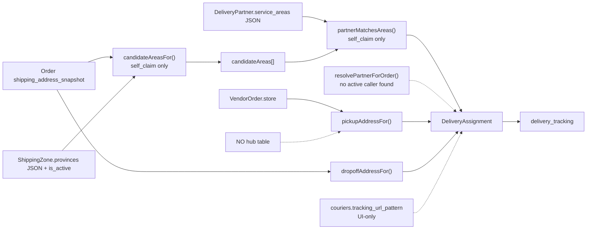

---

## 13. API Documentation

### 13.1 Address endpoints

| Method | Endpoint | Auth | Request | Response `data` |
|---|---|---|---|---|
| GET | `/api/v1/customer/addresses` | `auth:sanctum`, `ensure:customer` | — | Array of `CustomerAddressResource`. |
| POST | `/api/v1/customer/addresses` | same | `CustomerAddressRequest` fields | One address resource; 201. |
| GET | `/api/v1/customer/addresses/{address}` | same | UUID or numeric ID route key | One address resource; 404 if unowned. |
| PUT | `/api/v1/customer/addresses/{address}` | same | `CustomerAddressRequest` fields | Updated address resource. |
| DELETE | `/api/v1/customer/addresses/{address}` | same | — | 204, `data: null`. |
| PUT | `/api/v1/customer/addresses/{address}/default` | same | — | `{ address, default }`. |

### 13.2 Platform geo and settings endpoints

| Method | Endpoint | Auth | Query / body | Response message |
|---|---|---|---|---|
| GET | `/api/v1/platform/countries` | none; `throttle:public` | — | `Countries retrieved.` |
| GET | `/api/v1/platform/provinces` | none; `throttle:public` | — | `Provinces retrieved.` |
| GET | `/api/v1/platform/districts` | none; `throttle:public` | `province_id` optional integer | `Districts retrieved.` |
| GET | `/api/v1/platform/municipalities` | none; `throttle:public` | `district_id` optional integer | `Municipalities retrieved.` |
| GET | `/api/v1/platform/reverse-geocode` | none; `throttle:public` | `lat`, `lng` | `Location resolved.` / `Location approximated.` / 404. |
| GET | `/api/v1/platform/config` | none; `throttle:public` | — | Public config. |
| GET | `/api/v1/platform/social-providers` | none; `throttle:public` | — | Social providers. |
| GET | `/api/v1/admin/settings/shipping` | admin | — | `Shipping & return settings retrieved.` |
| PUT | `/api/v1/admin/settings/shipping` | admin | Bare shipping/COD/return keys | `Shipping & return settings updated successfully.` |
| GET / PUT | `/api/v1/admin/settings` | admin | Legacy batch payload | Legacy settings response. |
| PUT | `/api/v1/admin/settings/{key}` | admin | Single setting payload | Legacy setting response. |

Example reverse-geocode request:

```http
GET /api/v1/platform/reverse-geocode?lat=27.7172&lng=85.3240
```

Example approximated fallback response `data`:

```json
{
  "province": { "uuid": "<province-uuid>", "name": "Bagmati Province" },
  "district": { "uuid": "<district-uuid>", "name": "Kathmandu" },
  "municipality": { "uuid": "<municipality-uuid>", "name": "Kathmandu Metropolitan City" },
  "address_line": "Kathmandu",
  "display_name": "Kathmandu, Kathmandu, Bagmati Province, Nepal"
}
```

### 13.3 Checkout and order endpoints

| Method | Endpoint | Auth | Request | Response `data` |
|---|---|---|---|---|
| GET | `/api/v1/checkout/summary` | `auth:sanctum`, `throttle:auth` | `items`, `selected_item_ids`, or `item_ids` (comma string or array) | `{ item_count, subtotal, discount, delivery_charge, tax, total }`. |
| GET | `/api/v1/checkout/{session}` | same | session UUID | `CheckoutSessionResource`; 404 if not found. |
| POST | `/api/v1/checkout` | same | `shipping_address_id`, optional `billing_address_id`, `payment_method`, `item_ids` | `CheckoutSessionResource`; 201. |
| GET | `/api/v1/orders` | `auth:sanctum`, `ensure:customer`, `throttle:auth` | filters | Order collection. |
| POST | `/api/v1/orders` | same | `checkout_session_id`, optional `customer_notes` | `OrderResource`; order created. |
| GET | `/api/v1/orders/{order}` | same | UUID | `OrderResource`. |
| POST | `/api/v1/orders/{order}/cancel` | same | `CancelOrderRequest` | Updated order. |
| POST | `/api/v1/admin/orders` | admin | Flat `shipping_address` object plus order fields | Admin order resource; no address-book row. |
| POST | `/api/v1/vendor/orders` | vendor | Flat `shipping_address` object | Vendor order resource; no address-book row. |
| GET | `/api/v1/orders/{order}/tracking` | route group has no middleware; controller constructor applies `auth:sanctum` and `assertCanView()` allows order owner, super admin, related vendor, or assigned partner (403 otherwise) | order route key | Delivery tracking collection. |

Example summary response `data`:

```json
{
  "item_count": 2,
  "subtotal": "1500.00",
  "discount": "0.00",
  "delivery_charge": "80.00",
  "tax": "0.00",
  "total": "1580.00"
}
```

### 13.4 Admin shipping zone/courier endpoints

| Method | Endpoint | Request | Response |
|---|---|---|---|
| GET | `/api/v1/admin/shipping/zones` | `search`, `per_page` | Paginated `ShippingZoneResource`. |
| POST | `/api/v1/admin/shipping/zones` | Zone fields from Section 8.2 | 201 zone resource. |
| PUT | `/api/v1/admin/shipping/zones/{zone}` | Partial zone fields | Updated zone resource. |
| DELETE | `/api/v1/admin/shipping/zones/{zone}` | — | 200, `data: null`. |
| GET | `/api/v1/admin/shipping/couriers` | `search`, `per_page` | Paginated `CourierResource`. |
| POST | `/api/v1/admin/shipping/couriers` | `name`, `code`, `logo`, `contact_phone`, `contact_email`, `tracking_url_pattern`, `description`, `is_active` | 201 courier resource. |
| PUT | `/api/v1/admin/shipping/couriers/{courier}` | Partial courier fields | Updated courier resource. |
| DELETE | `/api/v1/admin/shipping/couriers/{courier}` | — | 200, `data: null`. |

Zone list response `meta.pagination` contains `total`, `per_page`, `current_page`, `last_page`.

### 13.5 Delivery endpoints relevant to address/shipping

| Method | Endpoint | Controller method |
|---|---|---|
| GET | `/api/v1/admin/deliveries/dashboard` | `AdminDeliveryController::dashboard()` |
| GET | `/api/v1/admin/deliveries/dispatch` | `AdminDeliveryController::dispatch()` |
| GET | `/api/v1/admin/deliveries/dispatch/{vendorOrder}` | `dispatchDetail()` |
| GET | `/api/v1/admin/deliveries/dispatch/{vendorOrder}/partners` | `dispatchPartners()` |
| POST | `/api/v1/admin/deliveries` | `assign(AssignDeliveryRequest $request)` |
| GET | `/api/v1/admin/deliveries/{assignment}` | `assignment()` |
| POST | `/api/v1/admin/deliveries/{assignment}/reassign` | `reassign()` |
| GET | `/api/v1/delivery-partner/available-jobs` | `DeliveryPartnerController::availableJobs()` |
| POST | `/api/v1/delivery-partner/available-jobs/{vendorOrder}/claim` | `claim()` |
| POST | `/api/v1/delivery-partner/assignments/{assignment}/deliver` | `deliver()` with OTP |
| GET | `/api/v1/admin/delivery-partners` | `AdminDeliveryController::partners()` |

Assignment resources expose `pickup_address`, `dropoff_address`, `recipient_name`, `recipient_phone`, `pickup_coordinates`, and `dropoff_coordinates`; coordinates are derived from store addresses and order snapshot/live-address fallback.

---

## 14. Frontend and Flutter Integration

### 14.1 React routes and components — IMPLEMENTED

Source: `frontend/src/App.jsx`, `frontend/src/pages/**`, `frontend/src/components/**`.

| Route / area | Active component | Purpose |
|---|---|---|
| `/checkout` | `frontend/src/pages/Checkout.jsx` | Address selection, add-address modal, checkout summary, order placement. |
| `/account/addresses` | `frontend/src/pages/account/AccountAddresses.jsx` | Address book CRUD and default selection. |
| `/admin/fulfillment/zones` | `frontend/src/pages/admin/AdminShipping.jsx` | Shipping zone and courier management behind `PermissionGuard`. |
| `/admin/settings` | `frontend/src/pages/admin/AdminSettings.jsx` + `components/admin/settings/ShippingTab.jsx` | Shipping fee/COD/return settings. |
| `/vendor/verification` | `frontend/src/pages/vendor/VendorVerification.jsx` | Vendor KYC location picker. |
| `/vendor/kyc` / seller onboarding | `frontend/src/components/vendor/SellerOnboardingCard.jsx` | Seller onboarding address + picker. |
| `/vendor/shipping` | `frontend/src/pages/vendor/VendorShipping.jsx` | Store pickup-location management; no zone/rate API calls. |
| `/vendor/shipping/labels` | `frontend/src/pages/vendor/VendorShippingLabels.jsx` | Shipping labels from order/snapshot data. |
| Delivery detail / active route / order detail | `frontend/src/pages/delivery/DeliveryDetail.jsx`, `DeliveryActiveRoute.jsx`, `frontend/src/pages/OrderDetail.jsx` | Uses `DeliveryRouteMap`. |

### 14.2 Location picker consumers — IMPLEMENTED

`LocationMapPicker` is imported by:

- `frontend/src/components/vendor/SellerOnboardingCard.jsx:17`
- `frontend/src/pages/account/AccountAddresses.jsx:11`
- `frontend/src/pages/Checkout.jsx:19`
- `frontend/src/pages/vendor/VendorVerification.jsx:16`
- `frontend/src/pages/admin/AdminManualOrderForm.jsx:9`

### 14.3 Frontend state and caching — IMPLEMENTED

- No address context/provider exists in `frontend/src/context`.
- `frontend/src/main.jsx:15-33` mounts `BrowserRouter`, `BrandingProvider`, `AuthProvider`, `ToastProvider`, `CartProvider`, `WishlistProvider`; no address provider.
- `frontend/src/api/client.js` caches GET responses for 20 seconds by default and invalidates cache after mutations. Address reloads after create/update/delete/default therefore fetch fresh data.
- `frontend/src/utils/searchLocation.js` stores nearby search coordinates in `sessionStorage` only.

### 14.4 Flutter integration — MISSING

Repository-wide checks found no:

- `*.dart` files
- `pubspec.yaml`
- Flutter project directories

All Flutter-related acceptance criteria in `.kiro/specs/delivery-address-shipping-audit/requirements.md` are **MISSING in this repository**. Any mobile app implementation outside this repository is **NOT VERIFIED**.

### 14.5 Frontend dependency graph — IMPLEMENTED

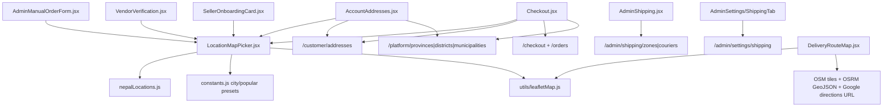

---

## 15. Complete File and Function References

### 15.1 Backend controllers

| File | Signatures |
|---|---|
| `app/Modules/Customer/Presentation/Http/Controllers/CustomerAddressController.php` | `index(): JsonResponse`, `store(CustomerAddressRequest $request): JsonResponse`, `show(CustomerAddress $address): JsonResponse`, `update(CustomerAddressRequest $request, CustomerAddress $address): JsonResponse`, `destroy(CustomerAddress $address): JsonResponse`, `setDefault(CustomerAddress $address): JsonResponse` |
| `app/Modules/Platform/Presentation/Http/Controllers/GeoController.php` | `countries(): JsonResponse`, `provinces(): JsonResponse`, `districts(Request $request): JsonResponse`, `municipalities(Request $request): JsonResponse`, `reverseGeocode(Request $request): JsonResponse`, `private matchProvince(array $address): ?Province`, `private matchDistrict(array $address, ?Province $province): ?District`, `private matchMunicipality(array $address, ?District $district, ?Province $province): ?Municipality`, `private buildAddressLine(array $address, string $displayName): string`, `private normalizeName(string $value): string`, `private extractCoreName(string $value): string`, `private fallbackReverseGeocode(float $lat, float $lng): JsonResponse` |
| `app/Modules/Platform/Presentation/Http/Controllers/AdminSettingsController.php` | `getShipping(): JsonResponse`, `updateShipping(UpdateShippingSettingsRequest $request): JsonResponse`, `getPayments(): JsonResponse`, `updatePayments(UpdatePaymentSettingsRequest $request): JsonResponse` |
| `app/Modules/Checkout/Presentation/Http/Controllers/CheckoutController.php` | `summary(): JsonResponse`, `create(CheckoutRequest $request): JsonResponse`, `show(string $session): JsonResponse` |
| `app/Modules/Order/Presentation/Http/Controllers/OrderController.php` | `index(Request $request): JsonResponse`, `store(PlaceOrderRequest $request): JsonResponse`, `show(Order $order): JsonResponse`, `cancel(CancelOrderRequest $request, Order $order): JsonResponse` |
| `app/Modules/Order/Presentation/Http/Controllers/AdminOrderController.php` | `manualCreate(Request $request): JsonResponse` |
| `app/Modules/Order/Presentation/Http/Controllers/VendorManualOrderController.php` | `store(Request $request): JsonResponse` |
| `app/Modules/Shipping/Presentation/Http/Controllers/AdminShippingController.php` | `zones(Request $request): JsonResponse`, `storeZone(Request $request): JsonResponse`, `updateZone(Request $request, string $zoneId): JsonResponse`, `deleteZone(string $zoneId): JsonResponse`, `couriers(Request $request): JsonResponse`, `storeCourier(Request $request): JsonResponse`, `updateCourier(Request $request, string $courierId): JsonResponse`, `deleteCourier(string $courierId): JsonResponse` |
| `app/Modules/Shipping/Presentation/Http/Controllers/AdminDeliveryController.php` | `dashboard(Request $request): JsonResponse`, `dispatch(Request $request): JsonResponse`, `dispatchDetail(VendorOrder $vendorOrder): JsonResponse`, `dispatchPartners(VendorOrder $vendorOrder): JsonResponse`, `partners(Request $request): JsonResponse`, `assignments(Request $request): JsonResponse`, `assignment(string $assignmentId): JsonResponse`, `assign(AssignDeliveryRequest $request): JsonResponse`, `assignmentHistory(VendorOrder $vendorOrder): JsonResponse`, `reassign(ReassignDeliveryRequest $request, DeliveryAssignment $assignment): JsonResponse` |
| `app/Modules/Shipping/Presentation/Http/Controllers/DeliveryPartnerController.php` | `apply(ApplyDeliveryPartnerRequest $request): JsonResponse`, `me(Request $request): JsonResponse`, `updateProfile(UpdateDeliveryPartnerProfileRequest $request): JsonResponse`, `setOnline(Request $request): JsonResponse`, `assignments(Request $request): JsonResponse`, `assignment(Request $request, DeliveryAssignment $assignment): JsonResponse`, `accept`, `pickup`, `outForDelivery`, `deliver(DeliveryConfirmationRequest $request, DeliveryAssignment $assignment): JsonResponse`, `fail(DeliveryFailureRequest $request, DeliveryAssignment $assignment): JsonResponse`, `returnToVendor`, `availableJobs(Request $request): JsonResponse`, `availableJobDetail(VendorOrder $vendorOrder): JsonResponse`, `claim(Request $request, VendorOrder $vendorOrder): JsonResponse` |
| `app/Modules/Shipping/Presentation/Http/Controllers/VendorOrderController.php` | `index(Request $request): JsonResponse`, `show(Request $request, VendorOrder $vendorOrder): JsonResponse`, `accept(Request $request, VendorOrder $vendorOrder): JsonResponse`, `reject(VendorOrderDecisionRequest $request, VendorOrder $vendorOrder): JsonResponse`, `readyForPickup(Request $request, VendorOrder $vendorOrder): JsonResponse` |
| `app/Modules/Shipping/Presentation/Http/Controllers/DeliveryTrackingController.php` | `orderTracking(Request $request, Order $order): JsonResponse` |

### 15.2 Backend services and models

| File | Signatures / symbols |
|---|---|
| `app/Modules/Customer/Application/Services/CustomerService.php` | `getOrCreateProfile(User $user): CustomerProfile`, `updateProfile(User $user, array $data): CustomerProfile`, `listAddresses(User $user): Collection`, `findAddress(User $user, string $uuid): ?CustomerAddress`, `createAddress(User $user, array $data): CustomerAddress`, `updateAddress(User $user, CustomerAddress $address, array $data): CustomerAddress`, `deleteAddress(User $user, CustomerAddress $address): void`, `setDefaultAddress(User $user, CustomerAddress $address): CustomerProfile`, `defaultAddressFor(User $user, string $type): ?CustomerAddress`, `protected resolveLocationIds(array $data): array` |
| `app/Modules/Checkout/Application/Services/CheckoutService.php` | `summary(User $user, ?array $selectedItemUuids = null): array`, `create(User $user, array $data): CheckoutSession`, `pendingFor(User $user, string $uuid): ?CheckoutSession`, `protected ownedAddress(User $user, string $uuid): ?CustomerAddress`, `protected taxFor($items): float`, `protected deliveryChargeForItems($items): float`, `protected deliveryCharge(float $subtotal): float`, `protected isGatewayEnabled(string $gateway): bool` |
| `app/Modules/Order/Application/Services/OrderService.php` | `placeOrder(User $user, CheckoutSession $session, ?string $notes): Order`, `cancel(User $user, Order $order, ?string $reason): Order`, `protected createOrder(User $user, CheckoutSession $session, $cart, ?string $notes): Order`, `protected createVendorOrder(Order $order, int $vendorId, $group, array $vendorDeliveryCharges): VendorOrder`, `protected vendorDeliveryCharges($items): array`, `protected deliveryCharge(float $subtotal): float`, `protected addressSnapshot($address): ?string` |
| `app/Modules/Shipping/Application/Services/DeliveryService.php` | `apply(User $user, ApplyDeliveryPartnerDTO $dto): DeliveryPartner`, `updateProfile(User $user, UpdateDeliveryPartnerProfileDTO $dto): DeliveryPartner`, `setOnline(User $user, bool $isOnline): DeliveryPartner`, `approve`, `reject`, `suspend`, `activate`, `assignOrder(User $actor, VendorOrder $vendorOrder, DeliveryPartner $partner, string $method = 'manual_admin', ?float $deliveryFee = null, ?float $codAmount = null, ?string $notes = null, bool $withinReassignment = false): DeliveryAssignment`, `assign(...)`, `claim(...)`, `reassign(...)`, `accept`, `pickup`, `outForDelivery(User $partnerUser, DeliveryAssignment $assignment): array`, `deliver(User $partnerUser, DeliveryAssignment $assignment, string $otp): DeliveryAssignment`, `fail`, `returnToVendor`, `dispatchList(array $filters): LengthAwarePaginator`, `dispatchSummary(): array`, `eligiblePartnersForOrder(VendorOrder $vendorOrder): array`, `dispatchDetail(VendorOrder $vendorOrder): array`, `markReadyForPickup(VendorOrder $vendorOrder, User $actor): VendorOrder`, `resolvePartnerForOrder(VendorOrder $vendorOrder): DeliveryPartner`, `trackingForOrder(Order $order): Collection`, `availableJobsForPartner(User $user, array $filters = []): LengthAwarePaginator`, `protected candidateAreasFor(VendorOrder $vendorOrder): array`, `protected partnerMatchesAreas(DeliveryPartner $partner, array $candidateAreas): bool`, `protected deliveryAreaFor(Order $order): array`, `protected recordTracking(DeliveryAssignment $assignment, DeliveryStatus $status, ?string $note = null, ?array $coords = null): DeliveryTracking`, `protected pickupAddressFor(VendorOrder $vendorOrder): string`, `protected dropoffAddressFor(Order $order): string` |
| `app/Modules/Shipping/Infrastructure/Models/ShippingZone.php` | `matchesLocation(?string $province = null, ?string $district = null, ?string $municipality = null): bool` |
| `app/Modules/Customer/Infrastructure/Models/CustomerAddress.php` | `user()`, `country()`, `province()`, `district()`, `municipality()`, `scopeForUser($query, $userId)` |
| `app/Modules/Platform/Application/Services/SettingsService.php` | `set(...)`, `updateGroup(string $group, array $values, ?User $actor = null, ?string $reason = null): array`, `getGroup(...)`, `clearCache(?string $group = null)` |
| `app/Modules/Vendor/Application/Services/VendorOnboardingService.php` | `apply(User $user, ApplyVendorDTO $dto): Vendor`, `submitKyc(...)`, location string→ID resolution in lines 69-98 |

### 15.3 Requests, resources, and frontend functions

| File | Signatures / symbols |
|---|---|
| `app/Modules/Customer/Presentation/Http/Requests/CustomerAddressRequest.php` | `authorize(): bool`, `rules(): array` |
| `app/Modules/Checkout/Presentation/Http/Requests/CheckoutRequest.php` | `rules(): array` |
| `app/Modules/Order/Presentation/Http/Requests/PlaceOrderRequest.php` | `rules(): array` |
| `app/Modules/Platform/Presentation/Http/Requests/UpdateShippingSettingsRequest.php` | `authorize(): bool`, `rules(): array` |
| `app/Modules/Customer/Presentation/Resources/CustomerAddressResource.php` | `toArray(Request $request): array` |
| `app/Modules/Checkout/Presentation/Resources/CheckoutSessionResource.php` | `toArray(Request $request): array` |
| `app/Modules/Order/Presentation/Resources/OrderResource.php` | `toArray(Request $request): array` |
| `app/Modules/Shipping/Presentation/Resources/ShippingZoneResource.php` | `toArray(Request $request): array` |
| `frontend/src/components/common/LocationMapPicker.jsx` | `LocationMapPicker({...})`, `normalizeProvince(p)`, `getDistrictsForProvinceExport(prov)`, `emitChange(data)`, `applyResolvedLocation(geo, lat, lng)`, `performReverseGeocode(lat, lng)`, `handleMapLocationChange(lat, lng)`, `handleProvinceChange`, `handleDistrictChange`, `handleMunicipalityChange`, `handleStreetChange`, `handleLandmarkChange`, `handleDetectLocation`, `handleApplyPreset` |
| `frontend/src/pages/account/AccountAddresses.jsx` | `load`, `resolveGeoIds(provinceName, districtName, municipalityName)`, `save(e)`, `remove()`, `setDefault(a)` |
| `frontend/src/pages/Checkout.jsx` | `saveAddress(e)`, `submitCheckout()` |
| `frontend/src/utils/nepalLocations.js` | `NEPAL_PROVINCES`, `NEPAL_DISTRICTS`, `NEPAL_MUNICIPALITIES`, `getDistrictsForProvince`, `getMunicipalitiesForDistrict`, `matchNepalLocation`, `reverseGeocodeLocal` |
| `frontend/src/utils/searchLocation.js` | `getSearchLocation()`, `saveSearchLocation(latitude, longitude)`, `clearSearchLocation()` |
| `frontend/src/components/delivery/DeliveryRouteMap.jsx` | `DeliveryRouteMap({...})`, `findApproximateCoords(address)`, `isNepalCoordinate(lat, lng)`, `normalizePoint(point, fallbackName, fallbackAddress)`, `routeEndpoint(point)`, `copyCoordinates()` |
| `frontend/src/utils/leafletMap.js` | `createOpenStreetMap(container, center, zoom = 12)`, `createRouteMarker(label, color)` |

### 15.4 Migrations and seeders

| File | Tables / purpose |
|---|---|
| `database/migrations/2026_08_15_000001_create_platform_tables.php` | `countries`, `provinces`, `districts`, `municipalities` |
| `database/migrations/2026_08_15_000002_create_vendor_tables.php` | `vendor_kycs`, `store_addresses`, vendor/store tables |
| `database/migrations/2026_08_15_000004_create_customer_tables.php` | `customer_profiles`, `customer_addresses` |
| `database/migrations/2026_08_15_000006_create_checkout_tables.php` | `checkout_sessions` |
| `database/migrations/2026_08_15_000007_create_order_tables.php` | `orders`, `vendor_orders`, order items/returns |
| `database/migrations/2026_08_15_000011_create_shipping_tables.php` | `delivery_partners`, `delivery_assignments`, `delivery_tracking`, `delivery_partner_documents`, `shipping_zones`, `couriers` |
| `database/seeders/NepalGeoSchemaSeeder.php` | Nepal country/province/district/municipality seed data |
| `database/seeders/SettingsSeeder.php` | Seeded shipping/checkout/payment/return setting keys |
| `database/seeders/QaTestDataSeeder.php` | QA-only `ZONE-X` / `ZONE-Y` shipping zones |
| `resources/js/location.js` | 753 raw Nepal local-level records used by backend seeder |

---

## 16. Existing Business Rules

| Rule | Status | Source |
|---|---|---|
| A user may have multiple addresses; `user_id` is the only ownership key. | **IMPLEMENTED** | `CustomerAddress` `hasMany`, non-unique `user_id`. |
| Address public identifier is UUID; numeric `id` is internal. | **IMPLEMENTED** | `HasUuid`, migrations, requests. |
| Address types are only `shipping` and `billing`. | **IMPLEMENTED** | `CustomerAddressRequest::rules()`. |
| Default is per user and per `address_type`. | **IMPLEMENTED in application only** | `CustomerService::setDefaultAddress()`. |
| No DB uniqueness prevents multiple defaults. | **IMPLEMENTED limitation** | `customer_addresses` migration. |
| Deleting a default address clears matching profile pointers. | **IMPLEMENTED** | `CustomerService::deleteAddress()`. |
| Setting `is_default: false` does not clear a profile pointer. | **IMPLEMENTED limitation** | `updateAddress()` only calls `setDefaultAddress()` on truthy value. |
| Checkout must receive an owned, non-soft-deleted address UUID. | **IMPLEMENTED** | `CheckoutService::ownedAddress()`. |
| Checkout accepts any owned address UUID regardless of `address_type`. | **IMPLEMENTED limitation** | `CheckoutRequest` + `ownedAddress()`. |
| Billing address falls back to shipping when omitted/unowned. | **IMPLEMENTED** | `CheckoutService::create()`. |
| Checkout session TTL is 30 minutes by default. | **PARTIAL** | Set in `create()`; no enforcement found. |
| Only `status = pending` sessions can become orders. | **IMPLEMENTED** | `OrderService::placeOrder()`. |
| Order address is a JSON snapshot, not a live FK-only reference. | **IMPLEMENTED** | `OrderService::addressSnapshot()`. |
| Cart total equals selected subtotal; shipping is deferred to checkout. | **IMPLEMENTED** | `CartResource.php:14-23`, `Cart.jsx:435-446`. |
| Delivery charge is flat per vendor group, waived at/above threshold. | **IMPLEMENTED** | `CheckoutService`, `OrderService`, `SettingsSeeder`. |
| COD availability is checked against `checkout.cod_enabled`, `payment.cod_enabled`, or bare `cod_enabled`. | **IMPLEMENTED** | `CheckoutService::create()` lines 77-79. |
| Free threshold must be > 0 to apply. | **IMPLEMENTED** | `$freeThreshold > 0 && $subtotal >= $freeThreshold`. |
| Zone matching is string-contains on province-name JSON. | **IMPLEMENTED** | `ShippingZone::matchesLocation()`. |
| Zone rates/ETA do not affect price or ETA. | **IMPLEMENTED limitation** | No consumer found. |
| Active zones are considered only in the `self_claim` service-area check. | **IMPLEMENTED / PARTIAL** | `where('is_active', true)` in `candidateAreasFor()`; called at `DeliveryService.php:249-253` only for `self_claim`. |
| Partners without `service_areas`, or wildcard/Nepal areas, match all candidates. | **IMPLEMENTED** | `partnerMatchesAreas()`. |
| `resolvePartnerForOrder()` requires approved + online and picks the most specific service-area list, but has no active production call site found. | **PARTIAL / DETACHED** | `DeliveryService.php:1169-1194`; repository-wide grep. |
| `resolvePartnerForOrder()` throws 422 when no partner is eligible; active `self_claim` throws 403 when outside approved areas. | **IMPLEMENTED** | `DeliveryService.php:1191`, `249-253`. |
| Admin/vendor manual orders bypass `customer_addresses`. | **IMPLEMENTED** | `AdminOrderController`, `VendorManualOrderController`. |
| Admin manual orders hardcode vendor-level `delivery_charge = 0`. | **IMPLEMENTED LIMITATION** | `AdminOrderController.php:675`. |
| Assignment-map coordinates are accepted only within Nepal-bounded latitude/longitude ranges. | **IMPLEMENTED** | `DeliveryAssignmentResource::coordinatePair()` lines 114-127. |
| GPS failure displays a Kathmandu fallback but emits `null` coordinates. | **IMPLEMENTED / WORKING TREE** | `LocationMapPicker::handleDetectLocation()` lines 400-407; `emitChange()` lines 136-141. |
| Leaflet map click or marker drag emits six-decimal exact coordinates. | **IMPLEMENTED / WORKING TREE** | `LocationMapPicker::handleMapLocationChange()` lines 263-270; handlers at 283-289. |
| Road-route geometry comes from public OSRM only when both endpoints are exact Nepal-bounded coordinates. | **IMPLEMENTED / WORKING TREE** | `DeliveryRouteMap.jsx:16-39,82-93,121-158`. |

---

## 17. Identified Limitations and Problems

### 17.1 Verified code-level issues

| # | Issue | Status | Impact | Evidence |
|---:|---|---|---|---|
| 1 | Frontend reverse-geocode path does not match registered route. | **IMPLEMENTED DEFECT** | Primary backend proxy is bypassed; direct Nominatim/local fallback becomes normal path. | `LocationMapPicker.jsx:225`; `Platform/Routes/api.php:17`. |
| 2 | District alias drift between frontend data and seeder. | **IMPLEMENTED DEFECT** | Geo FKs can remain null for Nawalparasi/Rukum/Kapilbastu variants. | `nepalLocations.js`; `NepalGeoSchemaSeeder.php`. |
| 3 | Shipping settings prefixed keys dropped by `validated()`. | **IMPLEMENTED DEFECT** | Admin “flat fee”/threshold edits may not affect checkout. | `ShippingTab.jsx:57-77`; `UpdateShippingSettingsRequest`; `AdminSettingsController::updateShipping()`. |
| 4 | Shipping zone rates and ETA unused. | **IMPLEMENTED LIMITATION** | Admin rate screens do not determine charged amount or delivery date. | `ShippingZone` model + no consumer in pricing. |
| 5 | No delivery hub/warehouse entity. | **MISSING** | Cannot model zone→hub dispatch; UI “hubs” is decorative. | Shipping migration grep; `AdminShipping.jsx`. |
| 6 | No forward geocoding/Places autocomplete. | **MISSING** | Users must pick from static dropdowns or use coordinate fallback. | Source-wide search. |
| 7 | Leaflet/draggable pin/OSRM routing exist only in uncommitted working-tree source. | **WORKING TREE / DEPLOYMENT PARITY NOT VERIFIED** | A stale deployed bundle would still show iframe/approximate behavior; tile/OSRM CSP, CORS, and provider-policy behavior are **NOT VERIFIED**. | `frontend/package.json:15`, `LocationMapPicker.jsx:263-289`, `DeliveryRouteMap.jsx:121-158`, `frontend/src/utils/leafletMap.js`, `public/index.html:12,16`. |
| 8 | No ward/tole/locality model. | **MISSING** | Address granularity stops at municipality + free-text street/ward. | Migrations; `nepalLocations.js`. |
| 9 | `customer_profiles.default_*_address_id` stores UUID but `belongsTo()` targets numeric `id`. | **LIKELY DEFECT; runtime NOT VERIFIED** | Profile default address serialization likely null. | `CustomerProfile.php`, `CustomerService::setDefaultAddress()`. |
| 10 | Checkout does not enforce `address_type`. | **IMPLEMENTED LIMITATION** | Billing-type address can be used as shipping address. | `CheckoutRequest`, `ownedAddress()`. |
| 11 | Checkout expiry is written but not enforced. | **IMPLEMENTED LIMITATION** | Stale sessions may remain usable if status is pending. | `CheckoutService.php:122,129-135`. |
| 12 | Order display backfills snapshot coordinates from live address. | **IMPLEMENTED LIMITATION** | Historical order display can change after address edits. | `OrderResource.php:18-22`. |
| 13 | `shipping_address_snapshot` is `varchar(1000)`. | **IMPLEMENTED LIMITATION** | Long addresses could be truncated; runtime **NOT VERIFIED**. | Order migration. |
| 14 | `VendorOrderResource` injects placeholder address values. | **IMPLEMENTED LIMITATION** | Missing data may display fabricated-looking defaults. | `VendorOrderResource.php:22-39`. |
| 15 | Duplicate hardcoded Nepal datasets. | **IMPLEMENTED RISK** | Frontend and backend can drift independently. | `resources/js/location.js`, `nepalLocations.js`. |
| 16 | Municipality map ignores province argument. | **STRUCTURAL RISK** | No current collision, but design is province-insensitive. | `getMunicipalitiesForDistrict(district, province)`. |
| 17 | Legacy address/checkout pages are dead but remain in source. | **IMPLEMENTED RISK** | Future import/routing could revive incompatible UI. | `pages/Customer/Addresses.jsx`, `pages/Public/Checkout.jsx`. |
| 18 | Courier tracking URL pattern has no outbound integration. | **IMPLEMENTED LIMITATION** | “API Webhook / Tracking Endpoint” label is misleading. | `AdminShipping.jsx`, `AdminShippingController`, no consumer found. |
| 19 | Rider tracking coordinates are never supplied by found call sites. | **IMPLEMENTED LIMITATION** | Live rider map is not backed by live coordinate updates. | `DeliveryService::recordTracking()` call sites. |
| 20 | No Flutter app. | **MISSING** | Any Flutter requirements are unsatisfied in this repository. | Recursive glob results. |
| 21 | Documentation staleness. | **DOC-ONLY / STALE** | Docs claim 208 municipalities and pending `/api/v1/shipping`; implementation differs. | `docs/02-architecture.md:52,80`. |
| 22 | Geo endpoints are public with only IP throttling. | **IMPLEMENTED** | Reverse geocode can be called without auth; abuse/rate behavior **NOT VERIFIED**. | `Platform/Routes/api.php:13-17`, `SharedServiceProvider.php:23`. |
| 23 | `resolvePartnerForOrder()` is detached; admin assign/reassign skip service-area matching. | **IMPLEMENTED LIMITATION** | Zone/partner coverage affects only self-claim eligibility; admin dispatch can assign outside declared areas. | `DeliveryService.php:249-253`, `342-361`, `432-441`, `1169-1194`; grep found no caller. |
| 24 | Admin manual orders hardcode vendor-level delivery charge to zero. | **IMPLEMENTED LIMITATION** | Manual-order vendor totals differ from customer orders even when an order-level charge is submitted. | `AdminOrderController.php:660-677`. |
| 25 | Assignment coordinates are filtered to hardcoded Nepal bounds. | **IMPLEMENTED LIMITATION** | Cross-border or malformed coordinates are silently returned as `null`. | `DeliveryAssignmentResource::coordinatePair()` lines 114-127. |

### 17.2 Not findings

The following do not exist in the verified implementation and should not be assumed:

- No `address_id` column or request field in customer/checkout code. The dead public checkout uses `address_id: 1` only.
- No `city`, `state`, `zip`, `default_address`, or `delivery_address` backend field in the customer address schema. `city`/`state` appear only as legacy snapshot fallbacks.
- No Flutter/Dart address screens.
- No production shipping-zone seeder.
- No geofencing/polygon serviceability check.
- No Express delivery selection in storefront.

---

## 18. Dependencies and Potential Breaking Changes

### 18.1 Dependency matrix — IMPLEMENTED

| Consumer | Depends on | Integration point | Change sensitivity |
|---|---|---|---|
| `AccountAddresses.jsx` | `/customer/addresses`, `/platform/*`, `LocationMapPicker` | Address CRUD, geo UUID resolution | High — payload keys and UUID/ID behavior are tightly coupled. |
| `LocationMapPicker.jsx` | `leafletMap.js`, Leaflet 1.9.4, OSM tiles, Nominatim proxy/direct fallback, local city table | Exact coordinate capture and reverse geocoding | High — exact/inexact state controls emitted `null` coordinates. |
| `DeliveryRouteMap.jsx` | `leafletMap.js`, Leaflet, OSM tiles, OSRM, external Google Maps URL | Pickup/dropoff/rider visualization | Medium-high — exact endpoint requirement and Nepal bounds gate route display. |
| `Checkout.jsx` | `/checkout/summary`, `/customer/addresses`, `/platform/*`, `/checkout`, `/orders` | Session + order creation | High — address UUID selection and totals shape. |
| `CheckoutService` | Cart, Customer, Platform settings, Payment config | `ownedAddress()`, `summary()`, `deliveryCharge()` | High — charge formula and settings key names. |
| `OrderService` | Checkout session, CustomerAddress, products/vendors, settings | Snapshot + totals + vendor orders | High — snapshot schema and charge persistence. |
| `DeliveryService` | Orders, VendorOrders, ShippingZone, DeliveryPartner, StoreAddress | Area matching and assignment | High — snapshot names and zone JSON strings. |
| `AdminShipping.jsx` | `/admin/shipping/zones`, `/admin/shipping/couriers`, local geo constants | Zone CRUD UI | Medium — field mapping and coverage semantics. |
| `ShippingTab.jsx` / `AdminSettings.jsx` | `/admin/settings/shipping`, legacy `/admin/settings` | Settings save/load | High — key naming must match settings readers. |
| `AdminAnalyticsController` | `orders.shipping_address_snapshot` | Province grouping | Medium — snapshot key rename breaks stats. |
| `OrderInvoiceMail` / `OrderStatusMail` | snapshot | Customer-facing address text | Medium. |
| `DeliveryAssignmentResource` / `AvailableJobResource` / `DispatchItemResource` | snapshot + live address fallback | Rider UI coordinates/address | Medium-high. |
| `VendorOnboardingService` | Platform geo tables + string inputs | Store address IDs | Medium — alias/name matching. |
| `PublicCatalogController` | session-stored lat/lng | Nearby product search | Low for delivery pricing; independent path. |

### 18.2 Potential breaking changes — impact analysis

| Potential change | Why it breaks current code | Affected files/tables |
|---|---|---|
| Rename `shipping_address_snapshot` keys | DeliveryService, analytics, resources, mail, manual-order fallbacks read exact keys. | `orders`, `DeliveryService`, `OrderResource`, `VendorOrderResource`, analytics, mail resources. |
| Change address geo IDs to UUID columns in `customer_addresses` | Current FKs are numeric integer IDs while API accepts UUIDs; `resolveLocationIds()` would need replacement. | migration, `CustomerAddress`, `CustomerService`, resources. |
| Make checkout price zone-based | Current summary/order totals are computed without address; session would need address-aware calculation and revalidation on address change. | `CheckoutService`, `OrderService`, `CheckoutSession`, `Checkout.jsx`. |
| Fix settings keys by renaming bare keys to prefixed keys | Existing rows and admin UI payloads contain both forms; readers use prefixed keys. Need data migration and UI alignment. | `settings`, `UpdateShippingSettingsRequest`, `ShippingTab`, `AdminSettings`, pricing services. |
| Introduce hub entity | Pickup currently comes from `store_addresses`; assignment resources expose `pickup_address` strings/coordinates. | new table, `DeliveryService::pickupAddressFor()`, assignment resources, admin UI. |
| Enforce address type at checkout | Existing clients may submit billing-type address as shipping; dead legacy client already sends incompatible payload. | `CheckoutRequest`, `Checkout.jsx`, legacy files. |
| Enforce checkout expiry | Pending sessions could become invalid; UX must handle expired session. | `CheckoutService::pendingFor()`, `Checkout.jsx`, `OrderController`. |
| Add ward-level master data | Current addresses store ward in free text; no FK/ID path exists. | migrations, `nepalLocations.js`, address form, snapshot. |
| Fix reverse-geocode path | Direct Nominatim fallback currently compensates; changing path changes provider load and response shape handling. | `LocationMapPicker.jsx`, `GeoController`, built assets. |
| Commit or revert uncommitted Leaflet map changes | Current source differs from the committed/deployed baseline; a stale bundle would preserve iframe/approximate behavior and mismatched package metadata. | `frontend/package.json`, `frontend/package-lock.json`, `LocationMapPicker.jsx`, `DeliveryRouteMap.jsx`, `frontend/src/utils/leafletMap.js`, `public/index.html`, `public/assets/*`. |
| Change OSRM endpoint or Nepal coordinate bounds | Direct browser fetch and duplicate `25–32` / `79–89.5` bounds exist in frontend and backend resources; cross-border points are dropped. | `DeliveryRouteMap.jsx`, `DeliveryAssignmentResource.php`. |
| Remove duplicate frontend geo dataset | Cascading dropdowns depend on local name strings; API consumers depend on name matching. | `nepalLocations.js`, `AccountAddresses.jsx`, `Checkout.jsx`, `AdminShipping.jsx`, `DeliveryProfile.jsx`. |

### 18.3 Dependency graph — IMPLEMENTED

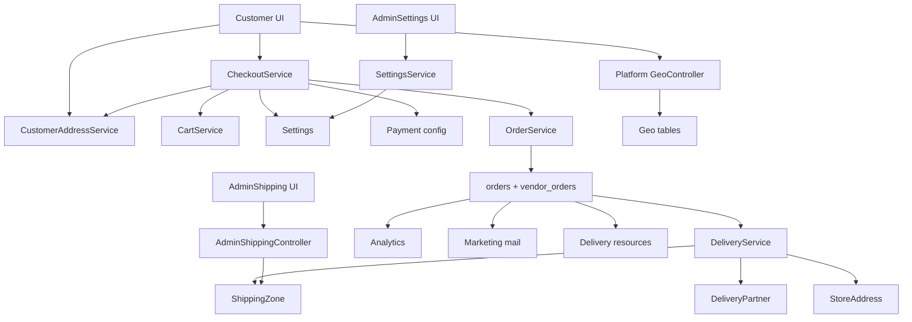

---

## 19. Proposed Hierarchical Architecture

**PROPOSED ONLY — nothing in this section is implemented.** This section evaluates feasibility based on existing tables/services and does not authorize or perform changes.

### 19.1 Target concept

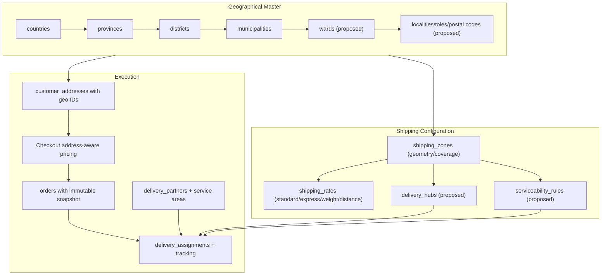

### 19.2 Gap analysis of existing support

| Proposed subsystem | Existing support | Gap / feasibility |
|---|---|---|
| Geographical Master | `countries`, `provinces`, `districts`, `municipalities` with FK hierarchy and 753-record source data. | Strong base. Missing wards, toles, boundaries/coordinates, name uniqueness, alias table, and API hierarchy validation. |
| Shipping Zone System | `shipping_zones` with UUID, name, JSON province names, `is_active`. | Feasible to normalize into zone coverage rows; current string matching is fuzzy and unversioned. |
| Shipping Rates | `standard_charge`, `express_charge`, `estimated_days`; settings flat fee/threshold. | Rates exist but are disconnected. Need rate table keyed by zone/service/mode and effective dates. |
| Delivery Hub | None. | New subsystem required. Current pickup source is `store_addresses`. |
| Delivery Partner | `delivery_partners` with service areas, approval, online state, coordinates. | Strong base. Need normalized service-area tables and zone/hub linkage. |
| Serviceability Rules | `matchesLocation()`, `partnerMatchesAreas()`, manual fallback. | Current rules are implicit in two methods; no rule table/versioning. |
| Address System | `customer_addresses` with geo FKs and snapshot. | Good base; needs ward-level IDs, address-type integrity, normalized snapshot schema. |
| Checkout pricing | Settings-based per-vendor formula. | Must become address-aware if zone pricing is adopted; requires session invalidation when address changes. |

### 19.3 Recommended separation principles — PROPOSED

1. Keep immutable order snapshots separated from mutable master addresses.
2. Make zone coverage reference master geo IDs instead of free-text names.
3. Store rates with effective dates, service mode, and currency; never infer price from admin UI labels.
4. Model hubs explicitly if dispatch origin affects fee or ETA.
5. Express serviceability should be a first-class rule, not an unused numeric column.
6. Preserve public UUIDs while introducing normalized internal relations.
7. Keep external geocoder results as evidence/candidate fields, not authoritative master IDs.

---

## 20. Recommended Migration Strategy

**PROPOSED ONLY — no migration or data transformation was executed.** This is an impact-aware sequence for future work.

### 20.1 Phase 0 — Baseline and data inventory

- Snapshot current schema, route list, settings rows, and zone rows.
- Confirm live DB row counts and settings values.
- Confirm whether deployed frontend bundle matches `frontend/src`.
- Inventory all snapshot key variants in production data, including manual orders.

### 20.2 Phase 1 — Fix correctness without schema redesign

- Align reverse-geocode path with `/api/v1/platform/reverse-geocode` or add an explicit compatibility alias.
- Align settings key names between `ShippingTab`, `UpdateShippingSettingsRequest`, and settings readers; include a data backfill plan for `shipping.flat_charge` / `shipping.free_delivery_threshold`.
- Add canonical alias mapping shared by frontend and seeder.
- Remove or quarantine dead legacy screens so they cannot be imported accidentally.
- Add read-only diagnostics for zone matches and partner eligibility before changing price behavior.
- Decide whether the uncommitted Leaflet map changes are the intended baseline; do not silently overwrite them during implementation.

### 20.3 Phase 2 — Normalize geography references

- Add alias/identifier tables for district/municipality variants.
- Add ward and locality/tole entities with parent-child FKs.
- Backfill from `customer_addresses.address_line_1`, `address_line_2`, `landmark`, and free-text snapshot values; leave uncertain values **NOT VERIFIED** rather than inventing IDs.
- Add cross-parent validation for district → province and municipality → district.

### 20.4 Phase 3 — Normalize zones, rates, hubs, and serviceability

- Create zone coverage rows referencing geo master IDs.
- Create versioned rate rows with service mode (`standard`, `express`) and effective windows.
- Create hub table and link stores/partners/zones as appropriate.
- Convert `delivery_partners.service_areas` JSON into normalized service-area rows while preserving raw JSON for rollback.
- Move `matchesLocation()`/`partnerMatchesAreas()` decisions into explicit serviceability rules with audit trail.

### 20.5 Phase 4 — Address-aware checkout

- Make checkout summary accept an address context without breaking existing calls.
- Recalculate charge server-side at order placement and persist a charge breakdown.
- Use immutable `checkout_sessions.shipping_breakdown` (column already exists) or an explicit breakdown table rather than relying only on a scalar total.
- Enforce session expiry with a user-visible recovery path.

### 20.6 Phase 5 — Rollout and rollback

- Dual-run old flat pricing and new zone pricing in shadow mode; compare outputs.
- Backfill and verify snapshots before switching consumers.
- Keep old columns nullable during transition; do not drop them in the same release.
- Provide rollback by reverting feature flags and retaining raw legacy JSON/string columns.
- Verify no pre-existing uncommitted user changes are overwritten when implementation work eventually begins.

---

## 21. Implementation Roadmap

**PROPOSED ONLY — phased delivery plan, not implemented.**

| Phase | Workstream | Deliverable | Exit criteria | Breaking-change risk |
|---|---|---|---|---|
| 0 | Discovery | Runtime route list, DB counts, settings values, deployed-bundle check | All Section 22 items resolved or explicitly accepted | None |
| 1 | Defect fixes | Reverse-geocode path alignment, settings key alignment, alias map sharing | Geocode proxy reachable; admin fee edits change effective setting | Medium |
| 1 | Dead-code cleanup | Remove/quarantine `Customer/Addresses.jsx` and `Public/Checkout.jsx` | No active route/import references | Low |
| 2 | Geo master | Ward/locality model and aliases; hierarchy validation | New tables populated with audited provenance | Medium-high |
| 2 | Address integrity | Address-type enforcement and default uniqueness policy | Duplicate defaults prevented; existing data reconciled | Medium |
| 3 | Zones/rates/hubs | Normalized coverage, versioned rates, hub entity | Zone-based charge can be computed in shadow mode | High |
| 3 | Partner service areas | Normalized areas + explicit serviceability rules | Assignment decisions reproducible and auditable | Medium-high |
| 4 | Checkout/order | Address-aware pricing and breakdown persistence | Summary and order totals agree; snapshots remain immutable | High |
| 4 | Maps | Commit/rebuild/verify current Leaflet draggable-pin implementation; add forward geocode and autocomplete; confirm OSM/OSRM policy | Source, installed packages, built bundle, and runtime behavior agree; no secret keys exposed | Medium |
| 5 | Delivery tracking | Rider location update endpoint and live route consumption | Tracking rows receive coordinates during active delivery | Medium |
| 5 | Flutter | Decide in-scope/out-of-scope | Explicit repository or external-app decision documented | N/A |

### 21.1 Suggested sequencing constraints

- Do not change pricing before zone/rate master data is verified.
- Do not normalize snapshots before all consumers are inventoried.
- Do not remove raw legacy JSON/string columns until a full order-history audit is complete.
- Do not introduce map SDK keys into client bundles; keep provider keys server-side where possible.
- Do not implement Flutter work in this repository unless a Flutter project is added deliberately.

---

## 22. Questions and Unverified Areas

### 22.1 Explicitly NOT VERIFIED

All items below are **NOT VERIFIED** because the audit was static and read-only:

1. **Runtime route list:** whether Laravel reports exactly the routes inferred from module route files and service-provider prefixes.
2. **Deployed frontend bundle:** whether production serves `frontend/src` output or a stale/different bundle. `public/index.html` references `index-DLZL_K3T.js` and `index-Crx1asnW.css`, and a built asset containing the wrong `/platform/geo/reverse-geocode` string was observed, but full bundle parity and deployment wiring are not verified.
3. **Proxy rewrites:** whether infrastructure rewrites `/api/v1/platform/geo/reverse-geocode` to `/api/v1/platform/reverse-geocode`.
4. **Nominatim behavior:** live availability, response payloads, rate limits, CORS behavior of direct browser calls, and provider usage-policy compliance.
5. **OSM tile and OSRM rendering:** whether Leaflet tiles and direct `router.project-osrm.org` fetches render/succeed under current CSP, CORS, network, and provider usage rules.
6. **Google Maps external directions:** actual user-device behavior and whether any API key is configured outside inspected config examples. No secret values were inspected or reported.
7. **Database state:** actual row counts in `countries`, `provinces`, `districts`, `municipalities`, `shipping_zones`, and settings keys/values. Fresh-seed simulation expects 753 municipality rows, but no DB was queried.
8. **Settings save runtime:** whether a successful admin save empirically drops prefixed keys as static Laravel `validated()` semantics indicate; whether legacy fallback runs in deployed usage.
9. **Snapshot truncation:** whether any real `shipping_address_snapshot` value exceeds `varchar(1000)` and is truncated.
10. **Profile default relations:** whether `CustomerProfileResource.default_shipping_address` / `.default_billing_address` are actually null in production due to UUID-vs-ID `belongsTo()` mismatch.
11. **Checkout expiry enforcement:** whether any external job/middleware outside `app/` enforces `checkout_sessions.expires_at`.
12. **Legacy page rendering:** whether dead pages are rendered by any non-React mechanism outside `frontend/src`.
13. **Alias-mismatch submissions:** whether production users actually encounter null geo IDs for alias-drift districts.
14. **Manual-order legacy snapshots:** whether production data contains `city`, `state`, or `zip` keys in snapshots.
15. **Courier integration:** whether an external system reads `couriers.tracking_url_pattern`; no outbound integration was found in `app/`.
16. **Rider live location:** whether deployed clients or external services update `delivery_tracking.latitude/longitude`; no in-repo route/call was found.
17. **Flutter app outside repository:** whether a separate mobile codebase exists elsewhere.
18. **Seller manual PDF text:** rendered PDF body text was not extracted; only generator/source text was inspected. All three seller-manual PDF copies had identical SHA-256, but no secret values are relevant here.
19. **Business truth of zone coverage:** whether current active zones intentionally cover the provinces/districts stored in their JSON arrays.
20. **Pre-existing uncommitted changes:** the working tree contained modified files (`OrderService.php`, `OrderResource.php`, `DeliveryService.php`, `AdminDeliveryController.php`, `DeliveryPartnerController.php`, `DeliveryAssignmentResource.php`, `QaTestDataSeeder.php`, `frontend/package.json`, `frontend/package-lock.json`, `LocationMapPicker.jsx`, `DeliveryRouteMap.jsx`, `OrderDetail.jsx`, `public/index.html`, `DeliveryAssignmentTest.php`) plus untracked Kiro spec assets, `frontend/src/utils/leafletMap.js`, and multiple `public/assets/index-*.js` / `.css` bundles. They were preserved and not assessed for authorship; their eventual intent is **NOT VERIFIED**.
21. **Dynamic invocation of `resolvePartnerForOrder()`:** no static call site was found in `app/`; any framework/reflection-based invocation outside static grep is **NOT VERIFIED**.
22. **Committed/deployed parity of Leaflet changes:** draggable pin, true Leaflet `event.latlng` clicks, and OSRM routing were found only in uncommitted source; parity with committed code and built bundles is **NOT VERIFIED**.

### 22.2 Questions for stakeholders

1. Should delivery pricing remain flat per vendor, or is zone/rate-based pricing an approved future requirement?
2. Are `shipping_zones.standard_charge` and `.express_charge` intended to be customer-facing prices, internal estimates, or stale UI fields?
3. What is the authoritative source for Nepal geography: `resources/js/location.js`, the seeder alias map, or an external master dataset?
4. Should wards and toles be modeled structurally, or remain free text?
5. Is there a published delivery hub/dispatch-center concept outside the codebase?
6. Are courier webhooks/tracking endpoints implemented in another service?
7. Is a rider-location update endpoint expected but missing, or intentionally out of scope?
8. Should checkout sessions expire strictly after TTL, and what user experience should replace an expired session?
9. Should billing address be persisted on `orders`, or is session-only billing intentional?
10. Is the Flutter app out of scope for this repository, in another repository, or not yet built?
11. Should `VendorOrderResource` placeholder address values be treated as intentional anonymization, or as a defect?
12. Which settings namespace is authoritative for shipping/COD/returns after the proposed key fix?
13. Should admin assignment/reassignment enforce declared service areas, or is manual override outside coverage intentional?

### 22.3 Closing statement

This audit documents the implementation as inspected. Where source evidence was conclusive, findings are labeled **IMPLEMENTED**, **PARTIAL**, or **MISSING**. Where runtime, deployed, provider, or data evidence was unavailable, the document uses **NOT VERIFIED**. Proposed architecture, migration strategy, and roadmap are explicitly separated and were not implemented during this audit.

